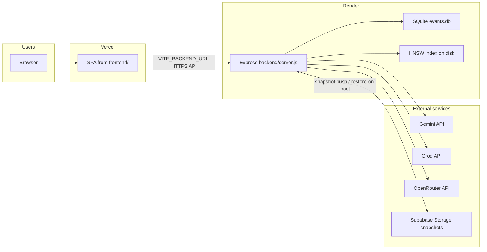
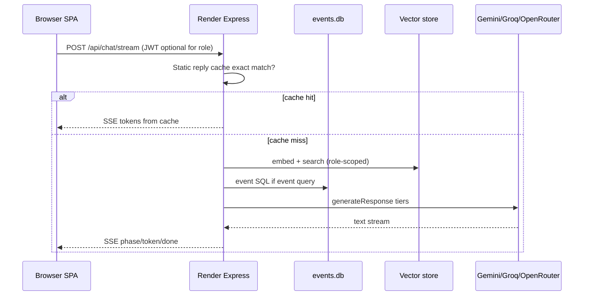
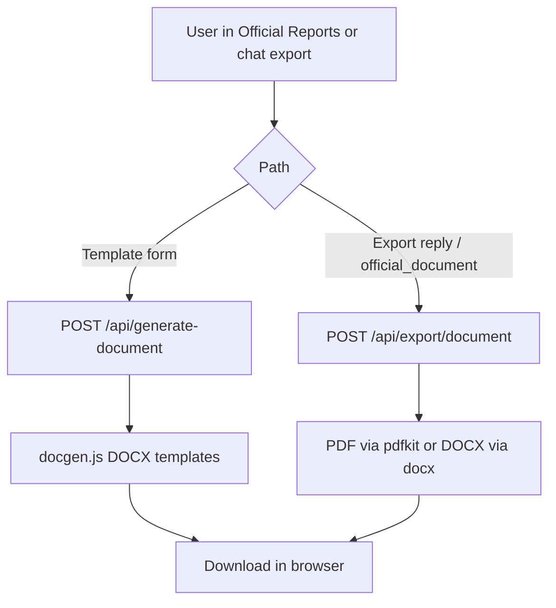
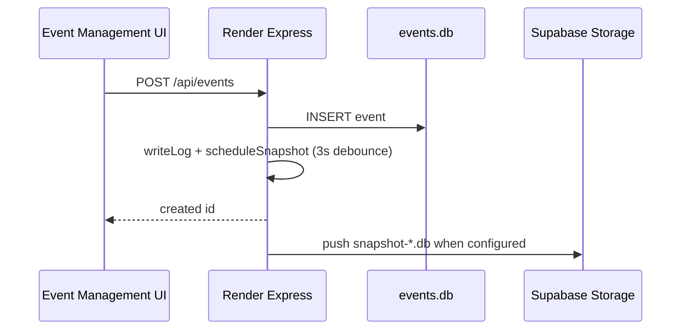
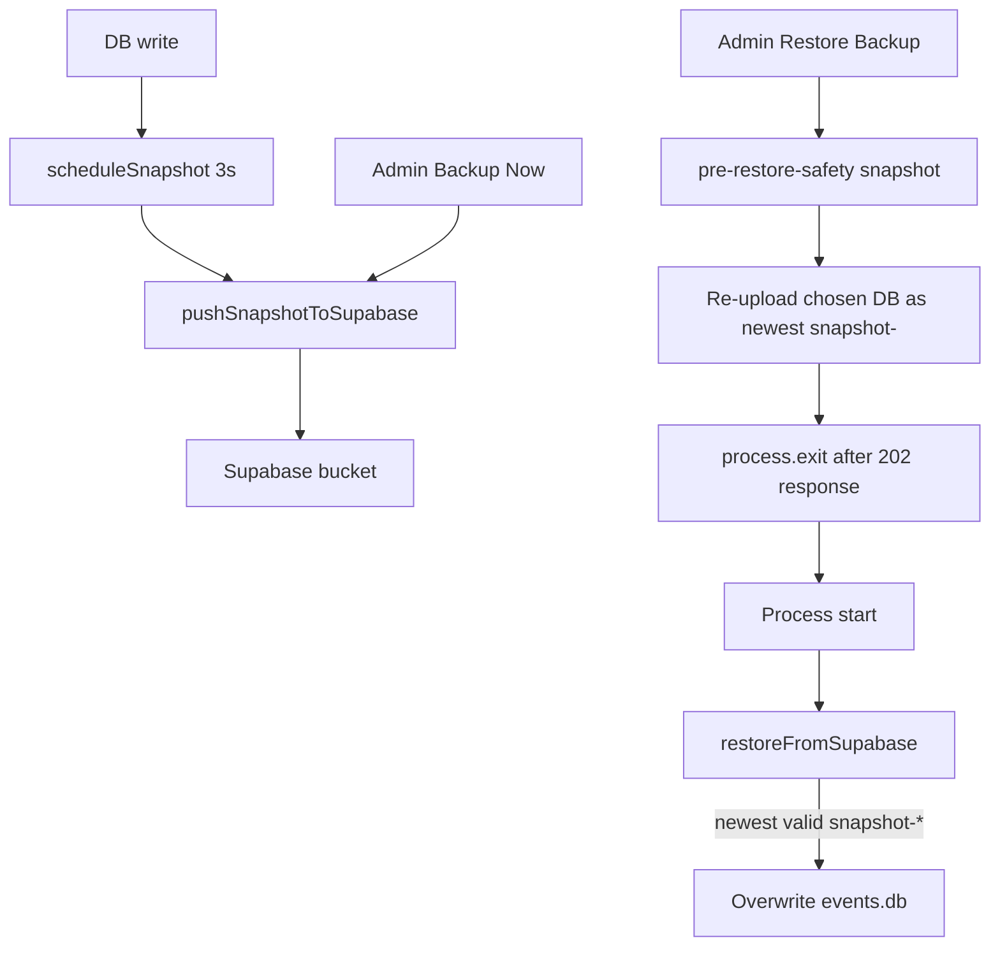

# aSK//YOUTH.AI — Software Maintenance Guide

| Field | Value |
|-------|-------|
| **Product** | aSK//YOUTH.AI (aSK Youth: An AI-Driven SK Management and Public Service System) |
| **Jurisdiction** | Sangguniang Kabataan, Barangay Concepcion Dos, Marikina City |
| **Document type** | Software maintenance guide (deployed system) |
| **Scope** | Deployed Vercel frontend (`frontend/`) and Render backend (`backend/`) only |
| **Revision** | 0.3 — Stage 2 complete (Ch. 3–6 + corrections; Stage 2.2 folded in) |
| **Status** | Draft — pending team verification of platform checklist items |

---

## Revision history

| Rev | Date | Author | Summary |
|-----|------|--------|---------|
| 0.1 | 2026-11-02 | [TO BE ASSIGNED BY TEAM] | Initial draft: front matter and Part I from Phase 0 / 0.5 audit of tracked `frontend/` and `backend/` |
| 0.2 | 2026-11-02 | [TO BE ASSIGNED BY TEAM] | Stage 1.1 corrections |
| 0.3 | 2026-11-02 | [TO BE ASSIGNED BY TEAM] | Stage 2: Ch. 3–6 appended; Stage 2.1 + 2.2 corrections (ERR-04, ERR-10, ERR-14, §2.4, Table 3-1, W-1, Table 6-1) |

---

## Table of contents

1. [Document conventions](#document-conventions)
2. [Part I — Introduction](#part-i--introduction)
   - [Chapter 1 — Introduction](#chapter-1--introduction)
   - [Chapter 2 — System Overview](#chapter-2--system-overview)
3. [Part II — Maintenance Operations](#part-ii--maintenance-operations)
   - [Chapter 3 — Maintenance Policy and Types](#chapter-3--maintenance-policy-and-types)
   - [Chapter 4 — Preventive Maintenance](#chapter-4--preventive-maintenance)
   - [Chapter 5 — Detecting and Reporting Problems](#chapter-5--detecting-and-reporting-problems)
   - [Chapter 6 — Recovery and Troubleshooting](#chapter-6--recovery-and-troubleshooting)
   - *(Chapters 7–12 to be appended in Stage 3)*
4. [Part III — Appendices](#part-iii--appendices) *(Stage 4)*

### List of figures

| ID | Description |
|----|-------------|
| Figure 2-1 | Deployed system architecture (Mermaid) |
| Figure 2-2 | Chat request data flow |
| Figure 2-3 | Document drafting / export data flow |
| Figure 2-4 | Event creation data flow |
| Figure 2-5 | Backup and restore data flow |
| *[Figure 2-6: Login — System Access — capture from live system]* | |
| *[Figure 2-7: Module sidebar by role — capture from live system]* | |

### List of tables

| ID | Description |
|----|-------------|
| Table 2-1 | Deployed components |
| Table 2-2 | Role and module access matrix |
| Table 2-3 | Data stores |
| Table 2-4 | External services |
| Table 2-5 | Platform limit consequences (verified vs unverified) |
| Table 3-1 | Maintainability sub-characteristics (ISO/IEC 25010) |
| Table 4-1 | Daily checklist (Proposed) |
| Table 4-2 | Weekly checklist (Proposed) |
| Table 4-3 | Monthly checklist (Proposed) |
| Table 4-4 | Pre-event checklist (Proposed) |
| Table 5-1 | Monitoring sources |
| Table 5-2 | Symptoms and likely causes |
| Table 5-3 | Severity levels and proposed response targets |
| Table 6-1 | Error and symptom reference |

---

## Document conventions

| Callout | Meaning |
|---------|---------|
| **Note** | Informational; no service risk if ignored. |
| **Caution** | Incorrect action may cause data loss, lockout, or degraded AI behavior. |
| **Warning** | High impact; may take the live service offline or overwrite the production database. |
| **Audience A** | System administrators / SK officials (non-developers): plain English, step-by-step. |
| **Audience B** | Maintainers / developers: technical detail, commands, configs. |
| `[VERIFY – platform dashboard]` | Cannot be confirmed from tracked source alone; confirm in Vercel, Render, or Supabase and record in Appendix P (Stage 4). |
| `[TO BE ASSIGNED BY TEAM]` / `[TO BE FILLED]` | Organizational assignment or contact not present in the repository. |

**Existence rule:** Statements in this guide describe only features that are (1) backed by tracked files under `frontend/` or `backend/`, (2) reachable in the deployed build, and (3) not dead or archived UI/code. Optional Python integrations called from `backend/server.js` are summarized once under [Optional integrations not deployed](#251-optional-integrations-not-deployed); they have no maintenance procedures.

---

# Part I — Introduction

## Chapter 1 — Introduction

**Audience:** A and B

### 1.1 Purpose

This guide describes how to operate and maintain the **deployed** aSK//YOUTH.AI system used by the Sangguniang Kabataan (SK) of Barangay Concepcion Dos, Marikina City. It covers preventive checks, problem detection, recovery, configuration change, backup/restore behavior, and verification—using only tools available on the live deployment (GitHub, Vercel, Render, Supabase, and the in-app Admin Dashboard).

### 1.2 Scope

**In scope**

- Static web application built from tracked `frontend/` and hosted on Vercel (`vercel.json`: build `cd frontend && npm install && npm run build`, output `frontend/dist`).
- Node.js Express API from tracked `backend/` (`npm start` → `node server.js`), hosted on Render.
- SQLite database file `backend/data/events.db` at runtime, with optional persistence via Supabase Storage snapshots.
- In-app modules rendered from `frontend/src/App.jsx` and related tracked frontend files.
- Cloud AI completion path implemented in `backend/llm_engine.js`.

**Out of scope**

- Local development machines, Cloudflare Tunnel, `askyouth-web-only/`, `ai-layer/`, `backend/tools/` (Python/PM2), and launcher scripts.
- Procedures that require localhost or on-PC services.
- Unbuilt or planned features (see Appendix L in Stage 4).

### 1.3 Audience

| Audience | Who | How this guide is written for them |
|----------|-----|-------------------------------------|
| **A** | System administrators and SK officials | Plain English; dashboard and in-app steps; expected results |
| **B** | Maintainers and developers | Routes, env var **names**, schema, auth behavior, recovery mechanics |

Each chapter or section states its primary audience. Mixed sections label subsections.

### 1.4 Manual organization

| Part | Contents | Delivery stage |
|------|----------|----------------|
| **I** | Introduction; system overview; architecture; roles; data flows | This revision (0.1) |
| **II** | Maintenance policy; preventive tasks; detection; recovery; change management; backup/DR; V&V; security; planning; RACI | Stages 2–3 |
| **III** | Forms, inventories, known issues, glossary, verification and platform checklists, source map | Stage 4 |

### 1.5 Related documents

Only documents that exist in the repository and relate to the deployed product are listed. Prefer the live UI and this guide for operational truth when docs conflict with tracked code.

| Document | Location | Use |
|----------|----------|-----|
| Users’ Guide (v2) | `Users-Guide-aSKYOUTH-v2.md` | End-user operation of modules |
| Users’ Guide | `Users-Guide-aSKYOUTH.md` | Earlier user documentation |
| Backend env template | `backend/.env.example` | Env var **names** and purpose (no secret values) |
| Vercel project config | `vercel.json` | Frontend build/output paths |
| README | `README.md` | Repository orientation `[VERIFY: currency vs deployed stack]` |

### 1.6 Escalation contacts

| Role | Responsibility | Contact |
|------|----------------|---------|
| System Administrator (app role `admin`) | Account unlock, backups, restore, user privilege changes | `[TO BE FILLED]` |
| SK Chairperson / officers | Day-to-day SK module use; escalate outages | `[TO BE FILLED]` |
| Technical maintainer | Render/Vercel/Supabase/GitHub changes | `[TO BE ASSIGNED BY TEAM]` |
| Hosting / API vendor support | Platform outages beyond application control | `[TO BE FILLED]` |

---

## Chapter 2 — System Overview

**Audience:** A (overview prose); B (tables, diagram, flows)

### 2.1 Architecture overview

**Audience:** A and B

The live system is a two-host deployment: a Vercel-hosted React single-page application (SPA) calls a Render-hosted Express API. The API uses SQLite on the service filesystem, pushes and restores database snapshots through Supabase Storage when configured, and obtains generative replies from cloud AI providers (Gemini, then Groq, then OpenRouter) defined in `backend/llm_engine.js`.

**Figure 2-1.** Deployed architecture (tracked code and configured hosts only). Exact Render/Vercel/Supabase project identifiers: `[VERIFY – platform dashboard]`.

*[Figure 2-6: Login page showing System Access, Username, Password, Sign In, and Continue as Youth — capture from live system]*

### 2.2 Component table

**Audience:** B (A: read “Role” and “Host” columns)

**Table 2-1. Deployed components**

| Component | Role | Host | Tech | Data held |
|-----------|------|------|------|-----------|
| Web SPA | UI, auth session in browser, modules | Vercel | React 18, Vite 5, Tailwind 4 (`frontend/`) | Chat threads in browser storage; JWT in `sessionStorage` |
| API service | Auth, CRUD, RAG, SSE chat, exports, admin APIs | Render | Node.js ESM, Express (`backend/server.js`) | Process memory: AI log ring, login lockouts, conversation metadata, thread uploads |
| Application database | Events, users, FAQ, suggestions, attendance, audit logs, embedding cache | Render filesystem path `backend/data/events.db` | SQLite via `better-sqlite3` | Persistent only for the life of the disk **unless** snapshotted |
| Vector index | Approximate nearest-neighbor search for RAG | Render filesystem under `VECTOR_STORE_DIR` (default `data/`) | `hnswlib-node` (brute-force fallback) | Chunk metadata/index files (not uploaded to Supabase by current code) |
| Snapshot store | Off-instance DB copies | Supabase Storage | REST object API from `server.js` | `snapshot-*.db`, `pre-restore-safety-*.db` |
| LLM providers | Generative chat and some extraction | Google / Groq / OpenRouter | `@google/generative-ai`, `groq-sdk`, axios | No SK database; prompt/content transit only |

### 2.3 Role and access matrix

**Audience:** A and B

Database roles (CHECK constraint in `backend/server.js`): `admin`, `chairman`, `officer`, `youth`.  
Guest access uses `POST /api/auth/youth-login` and a JWT with `role: 'youth'` and `isGuest: true` (displayed as Guest Youth on `/api/auth/me`). There is no separate `guest` database role.  
For AI prompts, JWT role `admin` is mapped to `system_admin` by `resolveActiveRole`.

**Table 2-2. Role and module access matrix** (sidebar modules from `getVisibleModules()` in `frontend/src/App.jsx`)

| Module (UI label) | `admin` | `chairman` | `officer` | `youth` / guest youth |
|-------------------|---------|------------|-----------|------------------------|
| AI Assistant | Yes | Yes | Yes | Yes |
| Scan Attendance | — | — | — | Yes |
| Suggestions | Yes | Yes | Yes | Yes |
| Event Management | Yes | Yes | Yes | — |
| Official Reports | Yes | Yes | Yes | — |
| FAQ | Yes | Yes | Yes | Yes |
| Admin Dashboard | Yes | Yes | — | — |

**Admin Dashboard tabs** (labels as rendered): Analytics; Users; Audit (`admin` only); System Health (`admin` only).

**ABYIP / admin-tier RAG:** vector scope `global_admin` is injected only when `resolveActiveRole` is `officer`, `chairman`, or `system_admin` (`GLOBAL_SCOPES` in `backend/server.js`). Youth/guest do not receive that scope.

*[Figure 2-7: Sidebar Modules list for an officer vs youth session — capture from live system]*

### 2.4 Data stores

**Audience:** B

**Table 2-3. Data stores**

| Store | Location | Created / migrated how | Survives Render restart? |
|-------|----------|------------------------|---------------------------|
| `events.db` | `backend/data/events.db` | Boot DDL + inline `ALTER` in `server.js`; optional restore from Supabase before open | Yes **if** a valid snapshot was restored or local disk retained; otherwise empty/seed path |
| `chunk_embeddings` | Table inside `events.db` | Boot DDL | With DB snapshot — cache only; chunk text not stored here (see §6.2) |
| HNSW files | Under `VECTOR_STORE_DIR` | Written by vector store at runtime | **No** guarantee; not part of Supabase snapshot upload |
| `system_logs` | Table inside `events.db` | Boot DDL | With DB snapshot |
| AI / Server log viewer | In-memory ring (max 250) | `AI_LOG_RING` in `server.js` | **No** |
| Chat thread titles/pins | In-memory `conversations` Map | API `/conversations*` | **No** |
| Uploaded thread documents | In-memory `threadDocuments` | Chat upload path | **No** |
| Browser chat history | Client storage | Frontend | Independent of Render restart |
| Auth JWT | Client `sessionStorage` | Login / youth-login | Until expiry or Sign Out; **not** revoked server-side on logout |

**Schema note (boot vs manual columns):** Boot migrations in `server.js` add event analytic columns and `category_other_label`. Columns `qr_token`, `qr_rotated_at`, and `faq_entries.visibility` are **not** added at boot; they come from standalone scripts (`migrate_qr.cjs`, `migrate_faq_visibility.cjs`) that are not part of the start path.

**Caution:** Live testing on 2026-11-02 confirmed QR generation/scanning and FAQ restricted visibility behave correctly (those columns are present in the live database). A **fresh** database without those manual migrations is a maintenance risk: QR and FAQ visibility SQL can fail until migrations are applied offline or a known-good snapshot is restored.

**ABYIP seed file and vector seeding:** On every startup, after `HNSWVectorStore.init()`, the server checks `vectorStore.metadata` for `global_admin` chunks. If they are absent (index not on disk, or disk wiped), it loads `../knowledge_base/abyip/abyip_2025_chunks.json` (path is relative to `backend/`; tracked at the repository root as `knowledge_base/abyip/abyip_2025_chunks.json`). This means ABYIP re-seeding occurs on **every restart or redeploy where the ephemeral disk was wiped**. The `chunk_embeddings` table (inside `events.db`) caches embedding vectors keyed by chunk hash; it is **not** the source of chunk text — chunk text comes from the JSON file. If the Render Root Directory is set to `backend` and `knowledge_base/` is not present on that service, ABYIP cannot be rebuilt from the snapshot alone. `[VERIFY – platform dashboard]` (Render Root Directory setting). A Proposed fix is noted in Appendix L.

### 2.5 External services

**Audience:** B

**Table 2-4. External services**

| Service | Purpose | Configuration (names only) |
|---------|---------|----------------------------|
| Vercel | Host SPA | `vercel.json`; env `VITE_BACKEND_URL` |
| Render | Host API | Start: `node server.js` / `npm start`; env per `.env.example` |
| Supabase Storage | DB snapshot objects | `SUPABASE_URL`, `SUPABASE_SERVICE_KEY`, `SUPABASE_BUCKET` (default name in code: `db-snapshots`) |
| Google Gemini API | Tier-1 completions | `GEMINI_API_KEY`; model IDs in `llm_engine.js` `[VERIFY – platform dashboard]` |
| Groq API | Tier-2 completions | `GROQ_API_KEY`; model `qwen/qwen3.8-27b` `[VERIFY – platform dashboard]` |
| OpenRouter API | Tier-3 completions | `OPENROUTER_API_KEY`; model `openrouter/free` `[VERIFY – platform dashboard]` |

#### 2.5.1 Optional integrations not deployed

**Audience:** B

Tracked `backend/server.js` may call `PYTHON_SERVICE_URL`, `ROUTER_URL`, `CONTEXT_URL`, and `LANGUAGE_URL` (defaults point at localhost). These backends are **out of scope** for deployed maintenance. When unreachable, deployed behavior is:

| Call site | Behavior when unreachable |
|-----------|---------------------------|
| Embeddings | Falls back to on-process Xenova `all-MiniLM-L6-v2` |
| Intent / summarize | Logged warning; chat continues with defaults / without summary |
| Tool router / language corrector / context compressor | Tools disabled; `<TOOL>` markup stripped from model text; no budget-estimator formatting via router |
| `POST /api/events/parse-document` | Request fails with HTTP 500 and an error message (Python parse step required first) |
| Image / scanned-PDF OCR | Extraction via Python OCR fails; user sees upload/parse failure |

Do not schedule PM2 or local Python upkeep as part of this guide.

### 2.6 Platform limits and operational consequences

**Audience:** A and B

**Table 2-5. Consequences tied to hosting model**

| Topic | What tracked code does | Stated as fact? |
|-------|------------------------|-----------------|
| Ephemeral / non-durable disk | Snapshot push/restore and SIGTERM emergency snapshot exist because the DB file can be lost on new instances | Mechanism **Confirmed** in `server.js` |
| Idle sleep / cold start delay | Not encoded as timings in repo | `[VERIFY – platform dashboard]` — observe Render behavior; do not assume minutes |
| API quotas | Local Gemini RPD counters + cascade to Groq/OpenRouter; counters reset on process restart | Cascade **Confirmed**; vendor quota numbers `[VERIFY – platform dashboard]` |
| CORS | Only origins in `CORS_ORIGINS` may call restricted API routes; `/health` and `/ready` use permissive CORS | **Confirmed** |
| Rate limit | 60 requests / minute / IP on `/api` | **Confirmed** in `server.js` |

**Note (Audience A):** If the first request after a period of inactivity is slow or fails with an uplink error, wait a moment and retry once; if it persists, escalate to the technical maintainer.

### 2.7 Data flows

**Audience:** B (A: follow the numbered summary under each figure)

#### 2.7.1 Chat

**Figure 2-2.** Chat flow (`POST /api/chat/stream` in `backend/server.js`; client in `frontend/src/App.jsx`).

1. User sends a message from AI Assistant.
2. API resolves role from JWT (`resolveActiveRole`; default `youth`).
3. Exact static-cache hit returns a canned answer without LLM.
4. Otherwise RAG + optional events context are built; admin-tier ABYIP chunks apply only to authorized roles.
5. `generateResponse` tries Gemini models in order, then Groq, then OpenRouter.
6. SPA renders streamed tokens; failures surface as `> UPLINK FAILED: …` or `No response received.`

#### 2.7.2 Document drafting and export

**Figure 2-3.** Document drafting/export (UI: Official Reports; Export Response / Export as DOCX|PDF).

Templates implemented in `backend/docgen.js`: `resolution`, `minutes`, `certificate`, `project_brief`. Export formats: `pdf`, `docx`.

#### 2.7.3 Event creation

**Figure 2-4.** Event creation (`POST /api/events`). Optional document-assisted field fill uses `POST /api/events/parse-document` (depends on optional Python; see §2.5.1).

#### 2.7.4 Backup and restore

**Figure 2-5.** Backup/restore as implemented in `backend/server.js`.

**Warning (Audience A):** Restore Backup overwrites the live database with a chosen snapshot after a safety copy is stored. The API then exits so the host restarts. Confirm the filename carefully in System Health.

**Note (Audience B):** `restoreFromSupabase` does **not** check whether the local file is empty; when Supabase is configured and a valid newest `snapshot-*` object is downloaded, it replaces `events.db`. Comment text in source that says “if missing or empty” does not match this behavior.

### 2.8 Startup sequence (backend)

**Audience:** B

1. Load env from `backend/.env` (on host: Render Environment).
2. `await restoreFromSupabase()` (no-op if Supabase env unset).
3. Open SQLite; run boot DDL / inline column migrations; sparse seeding as coded.
4. Init vector store; auto-seed `global_admin` / `global_public` when missing (ABYIP path subject to §2.4).
5. `scheduleSnapshot()`; listen on `PORT`.
6. SIGTERM/SIGINT → emergency snapshot push when Supabase configured.

Health probes: `GET /health` → `{ status: 'ok', … }`; `GET /ready` → `{ ready: true, message: 'Cloud AI Fallback Engine ready.' }`.

---

# Part II — Maintenance Operations

## Chapter 3 — Maintenance Policy and Types

**Audience:** A and B

This chapter defines the maintenance categories that apply to aSK//YOUTH.AI, with examples drawn from verified tracked code. The system's maintenance practices are **guided by** ISO/IEC 14764 (software maintenance), the maintenance process of ISO/IEC/IEEE 12207, and CMMI maintenance process areas. No formal compliance or certification is claimed.

### 3.1 Maintenance categories

**Audience:** A and B

#### 3.1.1 Corrective maintenance

**Definition:** Fixing confirmed defects or failures in the deployed system.

**Typical trigger:** A user reports a reproducible fault; monitoring shows error spikes; a symptom in Chapter 5 is confirmed.

**Example (code-backed):** When the AI fallback chain exhausts all tiers, `backend/llm_engine.js` throws `All AI fallback tiers failed. Last error: …`. Corrective action: rotate or replenish the API key for the failing tier (`GEMINI_API_KEY`, `GROQ_API_KEY`, or `OPENROUTER_API_KEY`) via the Render environment dashboard, then redeploy.

#### 3.1.2 Adaptive maintenance

**Definition:** Modifying the system to keep it working correctly in a changed environment (new provider model IDs, dependency updates, platform changes).

**Typical trigger:** An AI provider retires a model; a Node.js or npm dependency reaches end-of-life; Vercel or Render changes a build requirement.

**Example (code-backed):** Gemini model IDs in `GEMINI_MODELS` array (`backend/llm_engine.js`) are hardcoded strings. A provider that retires a model ID causes that tier to silently fail and cascade. Adaptive action: update the model ID in `llm_engine.js`, commit, and redeploy.

#### 3.1.3 Perfective maintenance

**Definition:** Improving performance, usability, or maintainability without changing functional behavior.

**Typical trigger:** Users report sluggish responses; HNSW brute-force fallback becomes slow as embedding count grows; code review identifies large monolithic files.

**Example (code-backed):** `backend/server.js` and `frontend/src/App.jsx` are large single-file modules. Splitting them into focused sub-modules is a perfective change that improves maintainability (see §3.2 assessment).

#### 3.1.4 Preventive maintenance

**Definition:** Proactive actions that reduce the probability of future failure.

**Typical trigger:** Scheduled review intervals (Chapter 4); dependency vulnerability advisories; approaching AI quota limits.

**Example (code-backed):** Rotating Gemini, Groq, and OpenRouter API keys before expiry or suspected compromise (`backend/.env.example` documents the key names) prevents silent tier failures.

#### 3.1.5 Emergency maintenance

**Definition:** Unplanned, immediate corrective action to restore a live service that is down or severely degraded.

**Typical trigger:** The health endpoint (`GET /health`) returns non-200; chat is failing for all users; the Render or Vercel dashboard shows an active outage.

**Example (code-backed):** If a Render restart restores a snapshot that causes widespread DB errors, use System Health → Restore Backup to promote a known-good earlier snapshot. `restoreFromSupabase()` validates each downloaded file with `better-sqlite3` (opens it and probes `sqlite_master`); a corrupt or truncated download is rejected and the local DB is kept. The real risk is that a valid but older snapshot silently overwrites current data — check the snapshot timestamp before confirming the restore (`backend/server.js` — `restoreFromSupabase`, `POST /api/admin/restore-backup`).

### 3.2 ISO/IEC 25010 Maintainability assessment

**Audience:** B

The following assessment is based on direct observation of tracked source files. It does not constitute a formal audit or certification.

**Table 3-1. Maintainability sub-characteristics (ISO/IEC 25010)**

| Sub-characteristic | Evidence | Assessment |
|--------------------|----------|------------|
| **Modularity** | `backend/server.js` is a single file containing auth, CRUD, RAG, SSE streaming, snapshot logic, and admin APIs. `frontend/src/App.jsx` contains all React components and state management in one file. `backend/llm_engine.js` and `backend/docgen.js` are separate, well-scoped modules. | **Mixed.** AI engine and document generator are well-isolated. Core server and UI are monolithic, raising coupling risk. |
| **Reusability** | Timestamp utilities are factored into two tracked files: `backend/timestamp_util.cjs` and `backend/timestamp_util.js` (confirmed: `git ls-files`). No shared component library between frontend modules; all components are inlined in `App.jsx`. | **Low-Medium.** Utility factoring exists; UI components are not reusable in isolation. |
| **Analysability** | Large file sizes (server.js ~3 000+ lines; App.jsx ~3 500+ lines) increase time to locate a defect. Function naming is generally descriptive. In-memory structures (lockout map, log ring) are undocumented as global state in a multi-instance scenario. | **Low–Medium.** Naming is clear but file length impedes navigation. |
| **Modifiability** | No automated tests mean every change carries regression risk. Manual-only migrations (`migrate_qr.cjs`, `migrate_faq_visibility.cjs`) require coordinated execution on a fresh DB — risk of schema mismatch. | **Low.** Absence of a test suite and manual migration dependency increase change risk. |
| **Testability** | No test runner, no test framework, no CI pipeline in tracked files (test scripts exist — `backend/test.js`, `test_llm_tiers.mjs`, etc. — but are not wired to CI). Smoke-test procedures must be manual (Chapter 9, Stage 3). | **Low.** No automated test coverage. |

**Note (Audience B):** These findings directly inform the maintenance effort distribution in Chapter 11 (Stage 3) and the Recommended Improvements in Appendix L (Stage 4).

---

## Chapter 4 — Preventive Maintenance

**Audience:** A (procedure steps); B (rationale and technical notes)

All schedules in this chapter are **Proposed**. They have not been formally approved by the SK team. Adjust intervals to match actual event cadences and staffing. Every task listed is executable using tools available on the live deployment: the in-app Admin Dashboard, Vercel dashboard, Render dashboard, Supabase dashboard, and GitHub.

### 4.1 Daily checks (Proposed)

**Audience:** A

**Purpose:** Verify the service is alive and that no new critical errors accumulated overnight.

**Table 4-1. Daily checklist (Proposed)**

| # | Task | Purpose | Where | Steps | Expected result | If abnormal |
|---|------|---------|-------|-------|-----------------|-------------|
| D-1 | Health probe | Confirm API is responding | Browser or Render dashboard | Open `<backend URL>/health` in browser; confirm response | `{"status":"ok","timestamp":"..."}` | See ERR-01 (Ch. 6) |
| D-2 | Ready probe | Confirm AI engine is initialized | Browser | Open `<backend URL>/ready` | `{"ready":true,"message":"Cloud AI Fallback Engine ready."}` | Escalate to technical maintainer |
| D-3 | Send a test chat | Confirm end-to-end chat flow | AI Assistant module | Log in; send a simple greeting; wait for a reply | Reply appears (observe and record typical response time) | See ERR-02, ERR-03 (Ch. 6) |
| D-4 | Check System Health tab | Confirm snapshot count and last backup timestamp | Admin Dashboard → System Health (admin only) | Log in as `admin`; open Admin Dashboard; click System Health tab; note the latest snapshot filename and timestamp | Snapshot timestamp is recent (today or yesterday) | Perform a manual backup (task D-5) |
| D-5 | Backup Now (if needed) | Push a fresh snapshot to Supabase | Admin Dashboard → System Health | In System Health, click **Backup Now**; wait for confirmation | Confirmation message; new snapshot appears in backup list | See ERR-09 (Ch. 6); escalate |

**Note (Audience A):** Step D-1 and D-2 can be bookmarked in your browser. You do not need to log in to run them.

### 4.2 Weekly checks (Proposed)

**Audience:** A and B

**Table 4-2. Weekly checklist (Proposed)**

| # | Task | Purpose | Where | Steps | Expected result | If abnormal |
|---|------|---------|-------|-------|-----------------|-------------|
| W-1 | Audit log review | Detect unexpected admin actions or failed logins | Admin Dashboard → Audit tab (admin only) | Log in as `admin`; open Admin Dashboard; click Audit tab; in the **Filter Action.** text box type `login_fail`; review entries for the past 7 days | No unexplained clusters of login failures | Investigate the account(s) involved; if suspicious, deactivate the account and escalate (§1.6) |
| W-2 | User account review | Ensure no orphaned or unauthorized accounts | Admin Dashboard → Users tab | Review user list; confirm all accounts are expected | All accounts belong to known SK personnel | Deactivate or remove unknown accounts |
| W-3 | AI/Server Log Viewer review | Spot AI tier failures or warning patterns | Admin Dashboard → System Health → AI / Server Logs | Review visible log entries (up to 250 most recent, not persistent across restart) | No repeated `[LLM Engine]` warn entries | Escalate if a tier is consistently failing (see ERR-02) |
| W-4 | Snapshot count verification | Ensure rolling backup is healthy | Admin Dashboard → System Health → backup list | Count listed snapshots; confirm the most recent is ≤24 h old | 1–5 snapshots listed; newest is recent | Manual backup (D-5) or check Supabase Storage `[VERIFY – platform dashboard]` |
| W-5 | Frontend availability | Confirm Vercel deployment is live | Vercel dashboard `[VERIFY – platform dashboard]` | Open Vercel project; check deployment status | Status: Ready; no build errors | Check build logs; see §7 (Stage 3) |

### 4.3 Monthly checks (Proposed)

**Audience:** B

**Table 4-3. Monthly checklist (Proposed)**

| # | Task | Purpose | Where | Steps | Expected result | If abnormal |
|---|------|---------|-------|-------|-----------------|-------------|
| M-1 | Dependency review | Identify outdated or vulnerable packages | GitHub repository | Open repository on GitHub; review `backend/package.json` and `frontend/package.json`; use GitHub Dependabot alerts if enabled `[VERIFY – platform dashboard]` | No critical CVEs outstanding | Update affected packages; test; redeploy (see §7 in Stage 3) |
| M-2 | AI model validity check | Confirm model IDs in `llm_engine.js` are still valid with providers | Gemini / Groq / OpenRouter provider consoles `[VERIFY – platform dashboard]` | Log in to each provider console; confirm each model ID in `GEMINI_MODELS` and Groq/OpenRouter model strings still exists and is accessible with the current API key | Models are listed and accessible | Update model IDs and redeploy; see §7 (Stage 3) |
| M-3 | API key rotation review | Reduce window of compromise from leaked keys | Render environment dashboard | Review when `GEMINI_API_KEY`, `GROQ_API_KEY`, `OPENROUTER_API_KEY` were last rotated; rotate if policy interval exceeded | Keys rotated within policy window | Rotate key in Render env; update in provider console; redeploy to apply (see ERR-11 in Ch. 6) |
| M-4 | FAQ and ABYIP content review | Keep public-facing answers current | AI Assistant and FAQ modules | Review FAQ entries for accuracy; ask the AI questions about current SK programs and compare to known facts | Answers are accurate and current | Update FAQ entries via the FAQ module (admin/chairman/officer); update ABYIP knowledge base if needed (Appendix L, Stage 4) |
| M-5 | Supabase storage check | Confirm snapshot storage has not exceeded quota | Supabase dashboard `[VERIFY – platform dashboard]` | Open Supabase project → Storage → `db-snapshots` bucket; check object count and total size | Quota not approaching limit | Delete aged `pre-restore-safety-*` objects manually; `snapshot-*` objects are pruned automatically to 5 by the application (`SNAPSHOT_KEEP = 5` in `backend/server.js`) |

**Caution:** `pre-restore-safety-*` snapshots are **not** auto-pruned by the application (`backend/server.js`). They must be deleted manually from Supabase Storage to prevent quota creep.

### 4.4 Before a major SK event (Proposed)

**Audience:** A

Run these checks 24–48 hours before any high-attendance SK event.

**Table 4-4. Pre-event checklist (Proposed)**

| # | Task | Where | Steps | Expected result |
|---|------|-------|-------|-----------------|
| E-1 | Force a fresh backup | Admin Dashboard → System Health | Click **Backup Now**; confirm success | New `snapshot-*` appears in backup list |
| E-2 | Verify QR generation | Event Management → event detail | Open the event; confirm QR code is displayed and scannable | QR renders; test scan succeeds |
| E-3 | Verify chat responds | AI Assistant | Ask an event-related question | Reply appears (observe and record typical response time) |
| E-4 | Check user accounts for scanning officers | Admin Dashboard → Users | Confirm scanning officers have valid accounts with the correct role | All accounts active |

### 4.5 Per SK term (Proposed)

**Audience:** A and B

At the start of each new SK term (or when chairperson / officer roster changes):

1. **Create new accounts** for incoming SK officials via Admin Dashboard → Users.
2. **Deactivate or delete accounts** for outgoing members.
3. **Rotate all API keys** (M-3 above).
4. **Verify contact escalation list** (§1.6) and update `[TO BE FILLED]` entries.
5. **Review FAQ entries** for outdated term-specific content.
6. **Confirm Render and Vercel environment variables** are current `[VERIFY – platform dashboard]`.

---

## Chapter 5 — Detecting and Reporting Problems

**Audience:** A and B

### 5.1 Monitoring sources

**Audience:** A and B

**Table 5-1. Monitoring sources**

| Source | What it shows | Persistent across restart? | Where to access |
|--------|--------------|---------------------------|-----------------|
| `GET /health` | API process alive; current timestamp | N/A (live call) | Browser: `<backend URL>/health`; no login needed |
| `GET /ready` | AI engine initialized | N/A (live call) | Browser: `<backend URL>/ready`; no login needed |
| System Health tab | Snapshot list and per-snapshot age/size (from Supabase); orphaned event log badge (count of `event_logs` rows referencing deleted events, labeled `orphaned logs detected` in UI); AI/Server Log Viewer (last 250 ring-buffer entries) | **No** — AI/Server log ring buffer (`AI_LOG_RING`, max 250 entries) is lost on restart; snapshot list re-fetched from Supabase on each tab load | Admin Dashboard → System Health (`admin` role only) |
| Audit tab (`system_logs` table) | All admin actions, login events, backup/restore, role changes | **Yes** — persisted in `events.db` and included in snapshots | Admin Dashboard → Audit (`admin` role only) |
| Render dashboard logs | Platform-level stdout/stderr, crash logs, deploy logs | `[VERIFY – platform dashboard]` — Render retention policy | Render project → Logs |
| Vercel dashboard logs | Build logs, function logs (if any) | `[VERIFY – platform dashboard]` | Vercel project → Deployments → Log |
| Supabase dashboard | Snapshot object list, storage usage, project health | `[VERIFY – platform dashboard]` | Supabase project → Storage → `db-snapshots` |

**Note (Audience B):** The AI/Server Log Viewer is backed by `AI_LOG_RING` (max 250 entries, in-memory, `backend/server.js`). All entries are lost on process restart. For persistent event history, use the Audit tab (`system_logs` table, persisted in snapshots).

### 5.2 Symptom–cause table

**Audience:** A and B

Exact symptom strings are quoted as they appear in tracked code.

**Table 5-2. Symptoms and likely causes**

| Symptom | Exact string / location | Likely cause | See |
|---------|------------------------|-------------|-----|
| Chat message shows `> UPLINK FAILED: …` | `frontend/src/App.jsx` `sendMessage` catch block | Network error reaching backend; backend crash; all AI tiers failed | ERR-02 |
| Chat message shows `No response received.` | `frontend/src/App.jsx` `sendMessage` SSE handler | SSE stream completed but no text tokens were emitted | ERR-02 |
| HTTP 429 from API | Response body: `Too many requests — please slow down.` (`backend/server.js` rate limiter) | More than 60 API requests/minute from one IP | ERR-04 |
| AI always returns an error after many requests | `All AI fallback tiers failed. Last error: …` thrown in `backend/llm_engine.js` | All three AI tiers (Gemini, Groq, OpenRouter) unavailable or quota exhausted | ERR-02, ERR-03 |
| QR code does not generate / attendance SQL errors on fresh DB | SQL errors referencing `qr_token` or `qr_rotated_at` columns | `migrate_qr.cjs` not run on this DB instance | ERR-06 |
| FAQ visibility not working on fresh DB | SQL errors referencing `faq_entries.visibility` column | `migrate_faq_visibility.cjs` not run on this DB instance | ERR-07 |
| Event data or users missing after redeploy | All DB data reverts to seed or is empty | `restoreFromSupabase()` at boot found no valid snapshot; or Render ephemeral disk was wiped without a Supabase snapshot | ERR-08 |
| Document upload / parse-document returns HTTP 500 | `POST /api/events/parse-document` calls `PYTHON_SERVICE_URL` which is unreachable in deployed build | Python microservice not running (out of scope for deployed build; see §2.5.1) | ERR-05 |
| Chat replies in Tagalog when the user message contained no Tagalog markers, or replies in English when Tagalog was intended | No error string; behavior in AI response | `TAGALOG_MARKERS` list in `backend/server.js` (function `generateChatResponse`) matched or failed to match a word in the query; the deterministic check drives the language instruction injected into the prompt — correctable in code by editing the marker list | ERR-14 |
| Officer or admin gets a refusal to draft documents | No error string; LLM refusal | Role override prompt injection (in `backend/server.js` chat/stream handler) may not be triggering; check `resolveActiveRole` result | ERR-15 |
| Admin Backup Now fails or shows error | No specific fixed string; error message from server | Supabase credentials missing or bucket inaccessible | ERR-09 |
| Login returns HTTP 429 with `Account temporarily locked due to too many failed attempts. Try again in N minute(s).` (while locked) or HTTP 401 with `Invalid credentials. Account locked for 15 minutes.` (on the 5th failure) | `backend/server.js` — `checkLockout` and `recordFailedAttempt` in the `POST /api/auth/login` handler | 5 consecutive failures for one username (`LOGIN_MAX_ATTEMPTS = 5`, `LOGIN_LOCKOUT_MS = 15 * 60 * 1000`) | ERR-10 |

### 5.3 Severity levels

**Audience:** A and B

All response targets below are **Proposed**.

**Table 5-3. Severity levels and proposed response targets**

| Level | Definition | Examples | Proposed response target |
|-------|-----------|---------|--------------------------|
| **Emergency** | Entire service down; no users can access chat, events, or admin functions | `/health` returns non-200; Render shows crashed service | Immediate: escalate to technical maintainer within 15 minutes |
| **High** | Core feature unavailable for all users (chat completely broken, DB inaccessible) | All AI tiers exhausted; DB missing after redeploy | Within 2 hours during business hours |
| **Medium** | Feature degraded or unavailable for a subset of users or roles | QR not working on fresh DB; FAQ visibility SQL error | Within 1 business day |
| **Low** | Cosmetic, minor behavioral inconsistency, or non-blocking issue | Occasional Tagalog reply to English input; chat slightly slow | Within the next maintenance window (weekly or monthly) |

### 5.4 Maintenance request and problem report process

**Audience:** A and B

1. **Observe and document** the symptom: note the exact error message, which module, which user role, timestamp, and steps to reproduce.
2. **Check Table 5-2** above for the likely cause and recommended error entry (Chapter 6).
3. **Determine severity** using Table 5-3.
4. **Submit a Maintenance Request (MR)** using the MR form template (Appendix A, Stage 4) via GitHub Issues `[VERIFY – platform dashboard: confirm Issues is enabled on the repository]` or the team's chosen tracker `[TO BE FILLED]`.
5. **Escalate** if severity is High or Emergency: contact the technical maintainer (§1.6) directly.
6. **Document resolution** in the MR and in the Incident Report (Appendix F, Stage 4).

**Note (Audience A):** If you are not a developer, you do not need to diagnose the cause. Record what you saw, what you were doing, and the exact words on screen, then submit the MR.

---

## Chapter 6 — Recovery and Troubleshooting

**Audience:** A (steps marked "Audience A" only); B (all steps including technical notes)

**Error IDs** (e.g., ERR-01) are guide-internal identifiers for cross-referencing. They are not system-generated codes.

### 6.1 Error and symptom reference

**Table 6-1. Error and symptom reference index**

| ID | Symptom (brief) | Audience | Proposed severity |
|----|-----------------|----------|-------------------|
| ERR-01 | `/health` not responding | A, B | Emergency |
| ERR-02 | `> UPLINK FAILED: …` or `No response received.` | A, B | High |
| ERR-03 | AI quota exhausted; chat failing after heavy use | B | High |
| ERR-04 | HTTP 429 `Too many requests — please slow down.` | A, B | Low |
| ERR-05 | `POST /api/events/parse-document` returns HTTP 500 | A, B | Medium |
| ERR-06 | QR code / attendance SQL error on fresh DB | A, B | Medium |
| ERR-07 | FAQ visibility SQL error on fresh DB | A, B | Medium |
| ERR-08 | Data missing after redeploy or restart | A, B | High |
| ERR-09 | Backup Now fails | A, B | Medium |
| ERR-10 | User locked out of login | A, B | Medium |
| ERR-11 | API key invalid; AI tier silently failing | B | High |
| ERR-12 | Frontend broken after Vercel deployment | A, B | High |
| ERR-13 | Backend crash or regression after Render deployment | A, B | Emergency/High |
| ERR-14 | Chat replies in wrong language | A, B | Low |
| ERR-15 | Officer/admin draft refused by AI | A, B | Low |

Detailed entries follow. Proposed severity levels align with Table 5-3.

#### ERR-01 — API not responding (`/health` fails)

| Field | Value |
|-------|-------|
| **Symptom** | `GET <backend URL>/health` returns non-200, times out, or returns an error page |
| **Cause** | Render service crashed; deployment failed; service sleeping (if on a plan with sleep) |
| **Recovery (A)** | 1. Wait and retry `/health` after a short interval. 2. If still failing, open the Render dashboard and check service status `[VERIFY – platform dashboard]`. 3. If Render shows a crash, click **Manual Deploy** to trigger a fresh deploy from the last good commit. 4. Monitor `/health` until it returns `{"status":"ok",...}`. |
| **Recovery (B)** | Check Render logs for the crash reason. If it is a dependency or build error, fix in code, commit, and redeploy. |
| **Escalation** | Technical maintainer if Render shows no error and service is not recovering. |
| **Evidence** | `backend/server.js` — `/health` route; `/ready` route |

---

#### ERR-02 — Chat shows `> UPLINK FAILED: …` or `No response received.`

| Field | Value |
|-------|-------|
| **Symptom** | AI Assistant message shows `> UPLINK FAILED: <error text>` or `No response received.` |
| **Cause (confirmed)** | (a) Network error between browser and backend; (b) all AI fallback tiers exhausted (`All AI fallback tiers failed. Last error: …` in `backend/llm_engine.js`); (c) backend process crashed mid-stream |
| **Recovery (A)** | 1. Wait a moment and retry the question. 2. If it persists for multiple questions, check `/health` (task D-1). 3. If `/health` is OK but chat still fails, escalate to technical maintainer. |
| **Recovery (B)** | 1. Check Render logs and the AI/Server Log Viewer (System Health tab) for `[LLM Engine]` warn/error entries. 2. If all three tiers are failing, check each API key: `GEMINI_API_KEY` (Render env → Google AI Studio `[VERIFY – platform dashboard]`), `GROQ_API_KEY` (Groq console), `OPENROUTER_API_KEY` (OpenRouter dashboard). 3. Rotate any key that is invalid or quota-exhausted (see ERR-11). |
| **Not observed** | Not observed as of 2026-11-02. |
| **Evidence** | `frontend/src/App.jsx` — SSE error handler (`> UPLINK FAILED` string) and stream completion handler (`No response received.`); `backend/llm_engine.js` — `generateResponse` throw |

---

#### ERR-03 — AI quota exhausted (specific tier)

| Field | Value |
|-------|-------|
| **Symptom** | Chat responses begin failing after a period of heavy use; Render logs show `[LLM Engine] Tier N (Provider) failed` or `marked exhausted` |
| **Cause (confirmed)** | Gemini in-memory RPD counters exhausted for all models in `GEMINI_MODELS`; or Groq/OpenRouter rate limit hit. Counters reset on process restart. |
| **Recovery (A)** | Escalate to technical maintainer. |
| **Recovery (B)** | 1. Check Render logs for which tier failed. 2. If Gemini: the local RPD counters reset on restart — a controlled redeploy (Manual Deploy in Render) resets them. Be aware this also re-runs `restoreFromSupabase()`. 3. If Groq or OpenRouter: check provider dashboard for rate-limit status `[VERIFY – platform dashboard]`. 4. Long-term: add additional model IDs or upgrade provider plan. |
| **Note** | Local Gemini RPD counters are in-memory and are lost on restart. Google's API enforces the real quota. |
| **Evidence** | `backend/llm_engine.js` — `_geminiCounters`, `_markExhausted`, `GEMINI_MODELS` |

---

#### ERR-04 — HTTP 429 Too many requests

| Field | Value |
|-------|-------|
| **Symptom** | API returns HTTP 429 with body `{"error":"Too many requests — please slow down."}` |
| **Cause (confirmed)** | More than 60 requests per minute from a single IP address hitting any `/api` route |
| **Recovery (A)** | Wait 60 seconds for the rate-limit window to reset automatically (the `windowMs` constant is 60 000 ms). Do not click or reload repeatedly. |
| **Recovery (B)** | This is expected behavior: the `apiLimiter` in `backend/server.js` is configured with hardcoded constants (`windowMs: 60 * 1000, max: 60`). To change the limit, edit `backend/server.js` and redeploy. No environment variable override exists for this limiter. |
| **Evidence** | `backend/server.js` — `apiLimiter` constant (`windowMs: 60 * 1000, max: 60`); `app.use('/api', apiLimiter)` |

---

#### ERR-05 — Document parse fails (HTTP 500 on event upload)

| Field | Value |
|-------|-------|
| **Symptom** | Uploading a document in Event Management returns HTTP 500 from `POST /api/events/parse-document` |
| **Cause (confirmed)** | `PYTHON_SERVICE_URL` is unreachable in the deployed build. The Python microservice that handles document parsing is out of scope for the deployed Render service (see §2.5.1). |
| **Recovery (A)** | Use manual field entry in Event Management instead of uploading a document. This feature requires the optional Python backend (not deployed). |
| **Recovery (B)** | Not available in current deployed build. The route exists in `backend/server.js` but requires a reachable `PYTHON_SERVICE_URL`. Document as known limitation. |
| **Evidence** | `backend/server.js` `POST /api/events/parse-document` route; §2.5.1 |

---

#### ERR-06 — QR code fails on fresh database

| Field | Value |
|-------|-------|
| **Symptom** | QR generation or attendance scan fails with a SQL error referencing `qr_token` or `qr_rotated_at` columns on a newly built database |
| **Cause (confirmed)** | `migrate_qr.cjs` was not run. These columns are not added by the boot DDL in `backend/server.js`; they come only from the standalone migration script. |
| **Recovery (A)** | Restore a known-good snapshot via System Health → Restore Backup (ERR-08 process). Confirm QR works after restart. |
| **Recovery (B)** | 1. Preferred: restore a known-good snapshot (the live production DB already has these columns, verified by live behavior 2026-11-02). 2. If a fresh DB must be used: run `node backend/migrate_qr.cjs` from the repository root `[VERIFY – platform dashboard: Render Shell availability]`. The script wraps each `ALTER TABLE` in a `try/catch`; running it on a DB that already has the columns is safe — it logs a message and continues. |
| **Evidence** | `backend/migrate_qr.cjs`; `backend/server.js` boot DDL (columns absent) |

---

#### ERR-07 — FAQ visibility not working on fresh database

| Field | Value |
|-------|-------|
| **Symptom** | FAQ restricted-visibility entries are not filtered; SQL error referencing `faq_entries.visibility` on a newly built database |
| **Cause (confirmed)** | `migrate_faq_visibility.cjs` was not run. The `visibility` column is not added by boot DDL. |
| **Recovery (A)** | Restore a known-good snapshot (same as ERR-06). |
| **Recovery (B)** | Run `node backend/migrate_faq_visibility.cjs` on the fresh DB `[VERIFY – platform dashboard: Render Shell availability]`. The script checks `PRAGMA table_info(faq_entries)` before attempting `ALTER TABLE`; it also checks for duplicate FAQ questions before inserting. Safe to re-run on a DB that already has the column. |
| **Evidence** | `backend/migrate_faq_visibility.cjs`; live behavior verified 2026-11-02 |

---

#### ERR-08 — Data missing after redeploy or restart

| Field | Value |
|-------|-------|
| **Symptom** | Events, users, or audit logs are empty or reverted to seed data after a Render redeploy or restart |
| **Cause (confirmed)** | (a) No valid Supabase snapshot exists; `restoreFromSupabase()` had nothing to restore and boot DDL re-seeded. (b) Render ephemeral disk was wiped and Supabase is not configured. (c) `restoreFromSupabase()` restored an older snapshot than expected. |
| **Recovery (A)** | 1. Log in to Admin Dashboard → System Health. 2. Check the backup list for available snapshots. 3. If a recent snapshot exists, click **Restore Backup** for the most recent known-good snapshot. 4. Confirm data is restored after the service restarts (observe actual restart time). |
| **Recovery (B)** | 1. If no snapshot exists: data loss has occurred. `pre-restore-safety-*` objects are included in the System Health backup list (returned by `GET /api/admin/backups`); select one and use **Restore Backup** to promote it. If none appear, access Supabase Storage directly `[VERIFY – platform dashboard]`. 2. Verify Supabase env vars (`SUPABASE_URL`, `SUPABASE_SERVICE_KEY`, `SUPABASE_BUCKET`) are set in Render `[VERIFY – platform dashboard]`. 3. After restore, run manual migrations if needed (ERR-06, ERR-07). |
| **Warning** | **Restoring a snapshot overwrites the live database.** The system takes a `pre-restore-safety-*` copy first, re-uploads the chosen snapshot as the newest `snapshot-*`, then triggers `process.exit(0)` — the service restarts (observe and record actual restart time for your Render plan). (`backend/server.js` — `POST /api/admin/restore-backup`) |
| **Evidence** | `backend/server.js` — `restoreFromSupabase`, `POST /api/admin/restore-backup` |

---

#### ERR-09 — Backup Now fails

| Field | Value |
|-------|-------|
| **Symptom** | Clicking Backup Now in System Health returns an error or the new snapshot does not appear |
| **Cause** | (a) Supabase credentials missing or invalid; (b) Supabase bucket name mismatch; (c) network error to Supabase from Render |
| **Recovery (A)** | Escalate to technical maintainer. |
| **Recovery (B)** | 1. Check Render environment for `SUPABASE_URL`, `SUPABASE_SERVICE_KEY`, `SUPABASE_BUCKET` `[VERIFY – platform dashboard]`. 2. Verify the bucket name matches the default (`db-snapshots`) or the configured value. 3. Check Supabase project status `[VERIFY – platform dashboard]`. |
| **Evidence** | `backend/server.js` `POST /api/admin/backup-db`; `pushSnapshotToSupabase` function |

---

#### ERR-10 — User locked out of login

| Field | Value |
|-------|-------|
| **Symptom** | (a) While locked: HTTP 429 with `Account temporarily locked due to too many failed attempts. Try again in N minute(s).`; (b) On the 5th failure: HTTP 401 with `Invalid credentials. Account locked for 15 minutes.`; (c) While attempts remain: HTTP 401 with `Invalid username or password. N attempt(s) remaining before lockout.` |
| **Cause (confirmed)** | 5 consecutive login failures for that username within the lockout window (`LOGIN_MAX_ATTEMPTS = 5`, `LOGIN_LOCKOUT_MS = 15 * 60 * 1000` in `backend/server.js`) |
| **Recovery (A — admin action)** | 1. Log in to Admin Dashboard as `admin`. 2. Go to the Users tab. 3. Find the locked user — a red badge shows remaining lock time. 4. Click the **Lift** button next to the badge to immediately clear the lockout. 5. Alternatively, wait 15 minutes for automatic expiry. |
| **Recovery (B — technical)** | `POST /api/admin/unlock-user` reads `username` from the request body and calls `clearFailedAttempts(username)` directly. It does **not** verify the JWT or the caller's role; any HTTP client that can reach the endpoint can clear a lockout. The UI's **Lift** button sends `X-Actor`, `X-Role`, and an `Authorization: Bearer <token>` header (via `authHeaders()` in `frontend/src/App.jsx`), but the server does not check them. This is a known security limitation documented in Appendix K and addressed as a Proposed improvement in Appendix L (add JWT + role middleware to this route). |
| **Warning** | The lockout state is **in-memory only**. A Render restart or redeploy clears all lockouts automatically. |
| **Evidence** | `backend/server.js` — `LOGIN_MAX_ATTEMPTS`, `LOGIN_LOCKOUT_MS` constants; `checkLockout`, `recordFailedAttempt`, `clearFailedAttempts` functions; `POST /api/admin/unlock-user` handler |

---

#### ERR-11 — API key invalid or expired

| Field | Value |
|-------|-------|
| **Symptom** | AI tier silently fails (Gemini error logged, falls through); all tiers eventually exhausted; or explicit auth error from provider |
| **Cause** | API key revoked, expired, or incorrect for the provider |
| **Recovery (A)** | Escalate to technical maintainer. |
| **Recovery (B)** | 1. Log in to Render dashboard `[VERIFY – platform dashboard]`. 2. Navigate to the backend service → Environment. 3. Update the affected key (`GEMINI_API_KEY`, `GROQ_API_KEY`, or `OPENROUTER_API_KEY`) with the new value from the provider console. 4. Save and redeploy. 5. Monitor `/health`, `/ready`, and a test chat message. |
| **Caution** | Any Gemini error, including an invalid model ID, is caught and logged as a warning; the system falls through silently. A bad key may not be immediately obvious — check AI/Server Logs for `[LLM Engine]` warn lines. |
| **Evidence** | `backend/llm_engine.js` — Gemini try/catch warn; `backend/.env.example` (key names) |

---

#### ERR-12 — Frontend rollback

| Field | Value |
|-------|-------|
| **Symptom** | After a Vercel deployment, the UI is broken or behaves unexpectedly |
| **Cause** | A deployment introduced a regression in `frontend/` |
| **Recovery (A)** | Escalate to technical maintainer. |
| **Recovery (B)** | 1. Open Vercel dashboard `[VERIFY – platform dashboard]`. 2. Navigate to the project → Deployments. 3. Identify the last known-good deployment. 4. Use Vercel's **Redeploy** or **Promote to Production** action on that deployment `[VERIFY – platform dashboard: exact UI label]`. 5. Verify the frontend loads correctly after promotion. |
| **Evidence** | `vercel.json`; `frontend/` tracked files |

---

#### ERR-13 — Backend rollback

| Field | Value |
|-------|-------|
| **Symptom** | After a Render deployment, backend behavior is incorrect or the service crashes |
| **Cause** | A deployment introduced a regression in `backend/` |
| **Recovery (A)** | Escalate to technical maintainer. |
| **Recovery (B)** | 1. Open Render dashboard `[VERIFY – platform dashboard]`. 2. Navigate to the service → Deploys. 3. Identify the last known-good deploy. 4. Use Render's rollback action `[VERIFY – platform dashboard: exact UI label and availability]`. 5. Alternatively, revert the commit in GitHub and push; Render will auto-deploy if connected `[VERIFY – platform dashboard]`. 6. Monitor `/health` and run a test chat. |
| **Warning** | Rolling back the backend does **not** roll back the database. If the failed deployment ran a migration or altered data, database state may be inconsistent. Restore from a pre-deployment snapshot if needed (ERR-08). |
| **Evidence** | `backend/server.js`; `backend/package.json` |

---

#### ERR-14 — Chat replies in wrong language

| Field | Value |
|-------|-------|
| **Symptom** | AI replies in Tagalog when the user's message contained no Tagalog markers, or replies in English when the user wrote in Tagalog |
| **Cause (code behavior)** | In `backend/server.js` (`generateChatResponse`), each word in `TAGALOG_MARKERS` is tested against the current query using a **whole-word, case-insensitive** regex (`new RegExp("\\b" + marker + "\\b", "i")`). If any marker matches as a whole word, a Filipino language instruction is appended to the prompt; if none match, an English-only instruction is appended. The instruction only advises the model — the model can still reply in the wrong language. This check is independent of the Python language corrector and runs on every deployed chat request. |
| **Recovery (A)** | Rephrase the message to avoid whole words that are in `TAGALOG_MARKERS` (e.g. "po", "ang", "sa", "ng") if English is intended, or include a clear Tagalog marker word if Filipino is intended. The match is whole-word only: "sample" does not trigger "sa", but a standalone "sa" does. If rephrasing does not help, the model may be overriding the instruction; use Recovery (B). |
| **Recovery (B)** | Correctable in code: edit the `TAGALOG_MARKERS` array in `backend/server.js` to add or remove marker words, then commit and redeploy. No Python corrector needed. |
| **Not observed** | Not observed as a confirmed persistent issue as of 2026-11-02. |
| **Evidence** | `backend/server.js` — `TAGALOG_MARKERS` array and `languageFlag` injection |

---

#### ERR-15 — Officer or admin draft refused by AI

| Field | Value |
|-------|-------|
| **Symptom** | An officer, chairman, or admin asks the AI to draft a new event proposal and receives a refusal |
| **Cause (suspected)** | The role override prompt (`[ROLE OVERRIDE: As an ${activeRole}, you are fully AUTHORIZED to draft...]` injected in `backend/server.js`) may not be triggering, or the LLM is ignoring it |
| **Recovery (A)** | Ensure you are logged in (not as guest/youth). Ask again; include the event parameters explicitly. |
| **Recovery (B)** | Verify that `resolveActiveRole` is returning `officer`, `chairman`, or `system_admin` for the request. Check that the JWT in the request is valid and contains the correct role. Check Render logs for any `[Chat]` errors. |
| **Not observed** | Not confirmed as a persistent issue as of 2026-11-02. |
| **Evidence** | `backend/server.js` — role override injection block in the `POST /api/chat/stream` handler (checks `['system_admin', 'chairman', 'officer'].includes(activeRole)`) |

---

### 6.2 Vector store behavior after restart

**Audience:** B

The HNSW binary index (`hnsw.index`) and metadata file (`hnsw-meta.json`) are written to `VECTOR_STORE_DIR` (default `data/`) on the Render ephemeral filesystem. They are **not** uploaded to Supabase. After a Render restart or ephemeral disk wipe, the following sequence occurs in `HNSWVectorStore.init()`:

1. **HNSW mode:** If `hnsw.index` and `hnsw-meta.json` exist on disk, the index and chunk metadata are loaded. If the files are absent (disk wiped), a new empty index is initialized.
2. **Brute-force fallback:** If `hnswlib-node` fails to load (native build error), the store falls back to brute-force cosine search. In brute-force mode, raw vectors are stored only in the in-memory `bruteVecs` Map (not persisted to disk); `hnsw-meta.json` records chunk text and metadata but not vectors. After a restart in brute-force mode with only `hnsw-meta.json` on disk, chunk metadata is restored but `bruteVecs` is empty — search returns no results until `addChunks()` is called again.
3. **Auto-seeding on boot:** After `init()`, the startup sequence checks `vectorStore.metadata` for `global_admin` chunks. If missing, it loads `../knowledge_base/abyip/abyip_2025_chunks.json` (path relative to `backend/`; see §2.4 for Root Directory dependency `[VERIFY – platform dashboard]`). Similarly, if `global_public` chunks are missing, published FAQ rows are re-seeded from the database.
4. **Embedding cache:** `addChunks()` checks the `chunk_embeddings` table in `events.db` for each chunk hash before calling the embedding model. If the snapshot was restored (ERR-08), cached vectors are reused without re-embedding. If the DB is empty, all chunks are re-embedded via Xenova `all-MiniLM-L6-v2` at startup.
5. **Thread documents:** `threadDocuments` (Map of uploaded file text, keyed by conversation ID) is in-memory only and is lost on every restart. Users must re-upload files to any active chat thread after a restart.

**Recovery:** Restore a recent Supabase snapshot so `chunk_embeddings` is populated (ERR-08). The index rebuilds at runtime from the cached vectors; no manual step is needed if the snapshot and seed file are both accessible.

**Evidence:** `backend/server.js` — `HNSWVectorStore` class (`init`, `addChunks`, `search`, `_save` methods); `vectorStore.init().then(...)` auto-seed block; `VECTOR_STORE_DIR` constant.

---

*(Chapters 7–12 to be appended in Stage 3.)*

---

# Part III — Appendices

*(Full appendices A–J, M–P to be written in Stage 4.)*

---

## Appendix K — Known limitations and technical debt

**Audience:** B

Items in this appendix describe limitations confirmed in code as of 2026-11-02. None were observed as active failures on the live site on that date.

| ID | Item | Location | Notes |
|----|------|----------|-------|
| K-1 | No server-side JWT revocation | `backend/server.js` — `POST /api/auth/logout` | Logout writes an audit log entry only; the JWT remains valid until expiry. |
| K-2 | Several routes accept role from `X-Actor`/`X-Role` headers without JWT gate | `backend/server.js` — `POST /api/admin/unlock-user`, `GET /api/admin/logs`, user and event mutation routes | Any caller who can reach the endpoint can pass arbitrary actor/role values. |
| K-3 | `POST /api/admin/unlock-user` does not verify JWT or role | `backend/server.js` — `unlock-user` handler | Any HTTP client that can reach the endpoint can clear an account lockout. The UI sends a valid JWT, but the server does not check it. Proposed fix: L-2. |
| K-4 | Dead UI: `mobileNavItems` array is incomplete | `frontend/src/App.jsx` — `mobileNavItems` | Mobile nav items are defined but do not match the full sidebar. |
| K-5 | Commented-out Purge Logs button | `frontend/src/App.jsx` | Button exists in code but is commented out; the purge endpoint exists in `server.js`. |
| K-6 | `token_blocklist` table unused | Supabase | Table present in schema but not referenced by deployed code; logout does not write to it. |
| K-7 | Static cache is exact-match only | `backend/server.js` — `staticReplyCache` | Rephrased semantically equivalent questions bypass the cache entirely. |
| K-8 | HNSW index on ephemeral disk | `backend/server.js` — `VECTOR_STORE_DIR` | Index files are lost on restart/wipe; ABYIP re-seeding depends on `../knowledge_base/abyip/abyip_2025_chunks.json` being present on the service. |
| K-9 | Boot restore can overwrite newer local data | `backend/server.js` — `restoreFromSupabase` | A valid but older Supabase snapshot silently overwrites local data on boot. |
| K-10 | Render ephemeral disk | Render platform | All files written to disk (HNSW index, `events.db` if not restored) are lost on restart unless covered by a Supabase snapshot. |

---

## Appendix L — Recommended improvements (not implemented)

**Audience:** B

Items are labeled **Proposed** and are not implemented in the current build.

| ID | Improvement | Priority | Notes |
|----|-------------|----------|-------|
| L-1 | Move `knowledge_base/abyip/abyip_2025_chunks.json` into `backend/` and update the load path in `server.js` | High | Eliminates Root Directory dependency for ABYIP seeding. Currently tracked at the repository root; if Render Root Directory is `backend`, the file is absent from the service. |
| L-2 | Add JWT + role middleware to `POST /api/admin/unlock-user` | High | Prevents unauthenticated lockout clearing (K-3). Apply the pattern used by `GET /api/admin/stats` (JWT gate already present there). |
| L-3 | Add JWT + role middleware to all routes that read actor/role from `X-Actor`/`X-Role` headers without verification | High | Covers `GET /api/admin/logs`, user and event mutation routes (K-2). |
| L-4 | Implement server-side token revocation | Medium | Addresses K-1; `token_blocklist` table already exists in Supabase (K-6) but is unused. |
| L-5 | Upload HNSW index files to Supabase alongside DB snapshot | Medium | Would allow the vector index to survive ephemeral disk wipe without full re-embedding on boot (K-8). |
| L-6 | Complete `mobileNavItems` array | Low | Bring mobile nav in line with sidebar items (K-4). |

---

## Appendix P — Platform verification checklist

*(Full checklist to be compiled in Stage 4 from all `[VERIFY – platform dashboard]` tags in this document.)*
