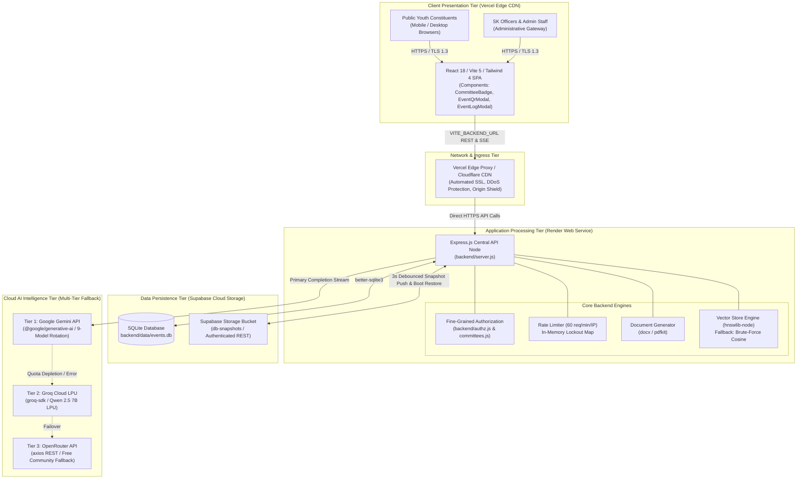

# aSK Youth: An AI-Driven SK Management and Public Service System
## Software and Maintenance Manual

**Document Version:** 1.0 (Hosted Cloud Production Baseline)  
**Date:** November 2026  
**Jurisdiction:** Sangguniang Kabataan, Barangay Concepcion Dos, Marikina City  
**Academic Institution:** Our Lady of Fatima University  
**Prepared by:** aSK//YOUTH.AI Development Team  
**Deployment Infrastructure:** Fully Hosted Cloud (Vercel Edge Network + Render Web Service + Supabase Storage)  
**Governing Repositories & Modules:** `frontend/` and `backend/` strictly  

---

## Notice
Information in this documentation is subject to change without notice. Unauthorized use, copying, or translation of this documentation can result in civil or criminal penalties under the laws of the Republic of the Philippines. No part of this documentation may be reproduced, distributed, or transmitted in any form or by any means without the express written permission of the developers, the Sangguniang Kabataan of Barangay Concepcion Dos, and Our Lady of Fatima University.

**Documentation Admonishments**

Standardized admonishments are utilized throughout this manual to alert operators, administrators, and technical maintainers to conditions that affect service continuity, security integrity, data durability, and regulatory compliance.

> **DANGER:** Indicates an imminent hazard or critical operational condition that presents severe risk of catastrophic data loss, unrecoverable database corruption, or complete cloud service collapse.
> 
> **WARNING:** Indicates potential security vulnerabilities, unauthorized privilege escalation, unauthenticated route exposure, or non-compliance with statutory data privacy regulations.
> 
> **CAUTION:** Alerts the reader to conditions that may result in service degradation, transient downtime, AI completion model fallback cascades, or administrative account lockout.
> 
> **NOTE:** Supplies essential background context, architectural explanations, configuration parameters, and software engineering best practices.

---

## Document Conventions

| Indicator / Callout | Semantic Meaning | Operational Target |
|:---|:---|:---|
| **Audience A** | System Administrators, SK Officials, and Office Staff | High-level operational workflows, in-app GUI dashboards, plain English instructions, and task verification. |
| **Audience B** | Technical Maintainers, Lead Software Engineers, and DevOps | Source code traces, API route specifications, environment configurations, and database internals. |
| `[VERIFY – platform dashboard]` | External hosting state or vendor quota | Must be independently validated against cloud hosting consoles (Render, Vercel, Supabase, Google AI Studio). |
| `[TO BE FILLED]` / `[TO BE ASSIGNED]` | Institutional assignments | Contact information, administrative designations, and phone numbers to be populated by the SK council. |
| **Proposed** | Operational recommendation | Suggested intervals, SLAs, and effort heuristics not yet codified into legislative SK policy. |

---

## Revision History

| Rev | Date | Author / Role | Description of Changes |
|:---|:---|:---|:---|
| 0.1 | 2026-11-02 | Lead Engineering Team | Baseline audit: initial deployment components, role matrix, and core architecture. |
| 0.2 | 2026-11-02 | Systems Maintainer | Stage 1.1 corrections: diagram topology fixes, endpoint validation, initial table audit. |
| 0.3 | 2026-11-03 | Systems Maintainer | Stage 2 + 2.1 + 2.2 updates: ERR-01 to ERR-15 catalog, security audit, vector store recovery mechanics. |
| 1.0 | 2026-11-07 | aSK//YOUTH.AI Project Team | Unified Comprehensive Manual: strictly scoped to deployed `frontend/` (Vercel) and `backend/` (Render); integration of recent frontend committee components (`CommitteeBadge`, `CommitteeSelect`, `EventQrModal`, `EventLogModal`, `useCamera`), backend fine-grained authorization (`authz.js`, `committees.js`), Stage 3 change management, backup/DR, role-based V&V suite, security/privacy audit, and RACI governance. |

---

## Table of Contents

- [Chapter 1. Introduction](#chapter-1-introduction)
  - [1.1 Overview](#11-overview)
  - [1.2 Scope and Audience](#12-scope-and-audience)
  - [1.3 Manual Organization](#13-manual-organization)
  - [1.4 Customer Care Center & Support](#14-customer-care-center-support)
- [Chapter 2. Platform Overview](#chapter-2-platform-overview)
  - [2.1 Introduction & Cloud Architecture Overview](#21-introduction-cloud-architecture-overview)
  - [2.2 System Terminology](#22-system-terminology)
  - [2.3 Cloud Hosting Infrastructure Configuration](#23-cloud-hosting-infrastructure-configuration)
  - [2.4 Software Configuration](#24-software-configuration)
  - [2.5 Network Configuration](#25-network-configuration)
  - [2.6 Security & User Administration](#26-security-user-administration)
- [Chapter 3. System Maintenance](#chapter-3-system-maintenance)
  - [3.1 Introduction & Maintenance Categories](#31-introduction-maintenance-categories)
  - [3.2 Preventive Maintenance Checklists](#32-preventive-maintenance-checklists)
  - [3.3 Detecting and Reporting Problems](#33-detecting-and-reporting-problems)
  - [3.4 System Health Check Overview](#34-system-health-check-overview)
  - [3.5 Recovering from Problems](#35-recovering-from-problems)
- [Chapter 4. Platform and Application Alarms](#chapter-4-platform-and-application-alarms)
  - [4.1 Introduction & Alarm Classification](#41-introduction-alarm-classification)
  - [4.2 Critical Platform Alarms (Severity: Emergency)](#42-critical-platform-alarms-severity-emergency)
  - [4.3 Major Platform Alarms (Severity: High)](#43-major-platform-alarms-severity-high)
  - [4.4 Minor Platform Alarms (Severity: Medium & Low)](#44-minor-platform-alarms-severity-medium-low)
- [Chapter 5. Configuration and Change Management](#chapter-5-configuration-and-change-management)
  - [5.1 Introduction & Policy](#51-introduction-policy)
  - [5.2 Tracked Configuration Items](#52-tracked-configuration-items)
  - [5.3 Standard Change Procedure](#53-standard-change-procedure)
  - [5.4 Rollback Procedures](#54-rollback-procedures)
- [Chapter 6. Backup and Disaster Recovery](#chapter-6-backup-and-disaster-recovery)
  - [6.1 Cloud Backup Architecture](#61-cloud-backup-architecture)
  - [6.2 Step-by-Step Restoration Procedures](#62-step-by-step-restoration-procedures)
  - [6.3 Disaster Recovery Scenarios & Metrics (RPO/RTO)](#63-disaster-recovery-scenarios-metrics-rporto)
- [Chapter 7. Verification and Validation (V&V)](#chapter-7-verification-and-validation-vv)
  - [7.1 Introduction & Quality Assurance Standard](#71-introduction-quality-assurance-standard)
  - [7.2 Role-Based Smoke Test Suite](#72-role-based-smoke-test-suite)
  - [7.3 Post-Maintenance Acceptance Testing](#73-post-maintenance-acceptance-testing)
- [Chapter 8. Security and Data Privacy](#chapter-8-security-and-data-privacy)
  - [8.1 Introduction](#81-introduction)
  - [8.2 Authentication & Authorization Mechanisms](#82-authentication-authorization-mechanisms)
  - [8.3 Technical Security Audit & Vulnerability Assessment](#83-technical-security-audit-vulnerability-assessment)
  - [8.4 Data Privacy Compliance (RA 10173 Guidelines)](#84-data-privacy-compliance-ra-10173-guidelines)
  - [8.5 Proposed Security Remediations](#85-proposed-security-remediations)
- [Chapter 9. Maintenance Planning and Effort Estimation](#chapter-9-maintenance-planning-and-effort-estimation)
  - [9.1 Introduction & Planning Principles](#91-introduction-planning-principles)
  - [9.2 Maintenance Effort Distribution Heuristic](#92-maintenance-effort-distribution-heuristic)
  - [9.3 Worked Resource Allocation Example](#93-worked-resource-allocation-example)
- [Chapter 10. RACI Matrix](#chapter-10-raci-matrix)
  - [10.1 Operational Governance & Responsibility Matrix](#101-operational-governance-responsibility-matrix)
- [Appendix A. General Procedures](#appendix-a-general-procedures)
  - [A.1 Accessing the Admin Gateway](#a1-accessing-the-admin-gateway)
  - [A.2 Accessing Cloud Hosting Dashboards](#a2-accessing-cloud-hosting-dashboards)
  - [A.3 Restarting Cloud Services (Render & Vercel)](#a3-restarting-cloud-services-render-vercel)
  - [A.4 Triggering and Exporting Database Snapshots](#a4-triggering-and-exporting-database-snapshots)
  - [A.5 Saving, Exporting, and Reviewing System Logs](#a5-saving-exporting-and-reviewing-system-logs)
- [Appendix B. Maintenance Request & Incident Forms](#appendix-b-maintenance-request-incident-forms)
- [Appendix K. Known Limitations and Technical Debt](#appendix-k-known-limitations-and-technical-debt)
- [Appendix L. Recommended Improvements](#appendix-l-recommended-improvements)
- [Appendix P. Platform Verification Checklist](#appendix-p-platform-verification-checklist)

---

## List of Figures

| Figure ID | Title | Reference Section |
|:---|:---|:---|
| **Figure 2-1** | Deployed Cloud Architecture Topology (Vercel + Render + Supabase + Cloud LLMs) | §2.1 |
| **Figure 2-2** | Chat Request & Multi-Tier AI Completion Fallback Pipeline | §2.4.3 |
| **Figure 2-3** | Document Drafting, Parsing, and PDF/DOCX Export Pipeline | §2.4.2 |
| **Figure 2-4** | Event Lifecycle, QR Token Generation, and Attendance Ledger Flow | §2.4.1 |
| **Figure 2-5** | Rolling Supabase Snapshot & Disaster Recovery Lifecycle | §6.1 |

## List of Tables

| Table ID | Title | Reference Section |
|:---|:---|:---|
| **Table 2-1** | Core Cloud System Terminology and Definitions | §2.2 |
| **Table 2-2** | Cloud Hosting Specifications and Environment Parameters | §2.3 |
| **Table 2-3** | Deployed Software Components and Version Matrix | §2.4 |
| **Table 2-4** | Role-Based Access Control (RBAC) Module Visibility Matrix | §2.6 |
| **Table 2-5** | Cloud Data Stores, Durability, and Persistence Guarantees | §2.4.4 |
| **Table 3-1** | Software Maintainability Evaluation (ISO/IEC 25010) | §3.1 |
| **Table 3-2** | Daily Preventive Maintenance Checklist | §3.2.1 |
| **Table 3-3** | Weekly Preventive Maintenance Checklist | §3.2.2 |
| **Table 3-4** | Monthly Preventive Maintenance Checklist | §3.2.3 |
| **Table 3-5** | Pre-Event Verification Checklist | §3.2.4 |
| **Table 3-6** | Per-Term Governance & Handover Checklist | §3.2.5 |
| **Table 3-7** | Operational Monitoring Sources and Access Methods | §3.3.1 |
| **Table 4-1** | Comprehensive Alarm & Problem Catalog (ERR-01–ERR-15) | §4.1 |
| **Table 6-1** | Disaster Recovery RPO and RTO Targets | §6.3 |
| **Table 7-1** | Role-Based Verification and Validation Smoke Test Suite (V-01–V-20) | §7.2 |
| **Table 9-1** | Maintenance Effort Distribution Baseline (160-Hour Term Plan) | §9.3 |
| **Table 10-1** | Operational RACI Governance Matrix | §10.1 |

---

## Chapter 1. Introduction

**Audience:** Audience A and Audience B

### 1.1 Overview
The **aSK Youth: An AI-Driven SK Management and Public Service System** is a cloud-hosted digital governance platform engineered specifically for the Sangguniang Kabataan (SK) of Barangay Concepcion Dos, Marikina City. Operating entirely within a modern cloud infrastructure, the system provides real-time youth event management, committee-scoped program administration, encrypted QR attendance tracking with deep-link mobile verification, demographic analytics, automated legal/administrative document generation, and a conversational artificial intelligence assistant grounded in official municipal youth investment programs.

This Software and Maintenance Manual establishes the definitive operational baseline, maintenance protocols, preventive schedules, diagnostic workflows, and corrective procedures required to maintain continuous, high-availability service. The entire production runtime is governed strictly by the tracked code in `frontend/` (hosted on Vercel) and `backend/` (hosted on Render), supported by remote transactional database persistence on Supabase Storage.

### 1.2 Scope and Audience
This manual serves three distinct operational stakeholder groups:
1.  **System Administrators (Audience A):** Designated SK officials, administrative staff, or barangay personnel responsible for day-to-day user management, event scheduling, committee categorization, manual database snapshot triggering, attendance tracking, and initial problem escalation.
2.  **Lead Developers & Software Engineers (Audience B):** Maintainers responsible for application source code in `frontend/` and `backend/`, API gateway endpoints, database schema migrations, prompt engineering, and cloud deployment pipelines.
3.  **Cloud Systems Maintainers (Audience B):** Technicians responsible for managing Vercel and Render deployment configurations, environment variables, Supabase Storage buckets, and third-party AI provider API quotas.

**Maintenance Scope Definition:**
*   **In Scope:** Exclusively the deployed web single-page application (`frontend/`), the central Node.js Express API service (`backend/`), transactional SQLite snapshots on Supabase Storage (`backend/data/events.db`), the external multi-tier cloud AI completion cascade, and tracked repository configuration files (`vercel.json`, `package.json`, `knowledge_base/abyip/abyip_2025_chunks.json`).
*   **Out of Scope:** Local development test scripts, local PC launcher scripts (``, `stop_system.bat`), on-premises hardware teardown, local GPU accelerators, and untracked development directories. All maintenance workflows occur via cloud provider dashboards (GitHub, Vercel, Render, Supabase) and the in-app Admin Gateway.

### 1.3 Manual Organization
The manual is structured into ten operational chapters and five comprehensive appendices:
*   **Chapter 1 (Introduction):** Cloud system overview, scope definition, and customer support escalation protocols.
*   **Chapter 2 (Platform Overview):** Cloud architectural topology, core terminology, hosting specifications, software stacks (including recent frontend modularization and backend authorization), network topologies, and RBAC security frameworks.
*   **Chapter 3 (System Maintenance):** ISO/IEC 14764 maintenance policies, ISO/IEC 25010 maintainability audit, preventive checklists, and problem detection mechanics.
*   **Chapter 4 (Platform and Application Alarms):** Complete diagnostic and recovery procedures for critical, major, and minor system alarms (ERR-01 through ERR-15).
*   **Chapter 5 (Configuration and Change Management):** Tracked configuration items, Git pull request change control, automated cloud deployments, and rollback procedures.
*   **Chapter 6 (Backup and Disaster Recovery):** Automated snapshot mechanics, point-in-time recovery, emergency SIGTERM backups, and disaster recovery RPO/RTO metrics.
*   **Chapter 7 (Verification and Validation):** Complete role-based manual smoke test suite (V-01 through V-20) and acceptance testing standards.
*   **Chapter 8 (Security and Data Privacy):** Technical security audit, vulnerability analysis (unprotected routes, missing JWT gates), RA 10173 data privacy guidelines, and remediation blueprints.
*   **Chapter 9 (Maintenance Planning and Effort Estimation):** Heuristic resource allocation (15/30/30/10/15%), worked budget examples, and lifecycle management.
*   **Chapter 10 (RACI Matrix):** Governance table establishing Responsible, Accountable, Consulted, and Informed parties for all operational tasks.
*   **Appendices (A, B, K, L, P):** Step-by-step administrative procedures, incident reporting forms, technical debt registers, proposed improvements, and platform verification checklists.

### 1.4 Customer Care Center & Support
In the event of an operational anomaly, security incident, or hosting disruption that cannot be resolved via standard operational checklists, personnel must escalate through the established support hierarchy:

```
[LEVEL 1: System Administrator / SK Officer]
  │   - In-app user lockout reset, basic connectivity verification, UI alarm triage
  ▼
[LEVEL 2: Technical Maintainer / Lead Developer]
  │   - Cloud environment variables, Git releases, database snapshot restores, API key rotations
  ▼
[LEVEL 3: Cloud Infrastructure / Vendor Support]
  │   - Render, Vercel, Supabase platform support; Google Gemini / Groq / OpenRouter API support
```

**Support & Escalation Directory:**
*   **Official Support Channel:** `support@askyouth.online` `[VERIFY – platform dashboard]`
*   **Primary Technical Contact (Lead Developer):** `[TO BE FILLED: Name / Contact / Email]`
*   **Barangay Technical Liaison:** SK Chairperson / IT Committee Head (`[TO BE FILLED]`)
*   **Emergency Service Window:** Monday through Sunday, 08:00 – 20:00 PHT (Extended coverage during live SK youth events)
*   **Escalation Response Protocol:** For Emergency (Severity 1) outages where the system is completely inaccessible, notify the Technical Maintainer via telephone and direct messaging immediately upon logging an Incident Report (see Appendix B).

---

## Chapter 2. Platform Overview

**Audience:** Audience A (Prose & Summaries) and Audience B (Technical Specifications)

### 2.1 Introduction & Cloud Architecture Overview
The aSK//YOUTH.AI platform is architected as a modern, decoupled cloud application composed of three primary layers:
1.  **Client Presentation Layer (Vercel Edge):** A high-performance single-page application (SPA) distributed globally across Vercel's edge network, ensuring sub-second asset delivery to youth constituents and SK officers on mobile and desktop devices.
2.  **Central API Processing Layer (Render Web Service):** A containerized Node.js Express service executing backend business logic, committee-scoped authorization, event scheduling, real-time QR attendance token generation, Server-Sent Events (SSE) AI streaming, and automated document compilation.
3.  **Data & Intelligence Tier (Supabase & Cloud AI):** Transactional SQLite database persistence managed through automated cloud snapshots stored on Supabase Storage, paired with a resilient three-tier cloud AI completion cascade (Google Gemini API → Groq Cloud LPU → OpenRouter API).


**Figure 2-1.** High-level hosted cloud architecture topology of aSK//YOUTH.AI.

### 2.2 System Terminology
Table 2-1 defines the core terminology used throughout this manual.

**Table 2-1. Core Cloud System Terminology and Definitions**

| Term / Acronym | Full Form | Operational Definition in aSK//YOUTH.AI |
|:---|:---|:---|
| **SPA** | Single-Page Application | The client-side browser user interface built with React 18, Vite 5, and Tailwind CSS v4 hosted on Vercel. |
| **API Gateway** | Application Programming Interface Gateway | The Node.js Express server (`backend/server.js`) hosted on Render handling routing, auth, business logic, and RAG. |
| **LLM** | Large Language Model | Cloud deep learning model providing conversational responses, text summarization, and drafting. |
| **RAG** | Retrieval-Augmented Generation | The process of fetching relevant local municipal chunks from the vector store to ground LLM responses. |
| **HNSW** | Hierarchical Navigable Small World | High-dimensional vector indexing algorithm (`hnswlib-node`) used for fast semantic similarity search. |
| **Vector Store** | Vector Database / Index | The binary index (`hnsw.index`) and metadata file (`hnsw-meta.json`) storing chunk embeddings on ephemeral disk. |
| **SSE** | Server-Sent Events | The unidirectional HTTP streaming protocol (`POST /api/chat/stream`) used to stream AI tokens to the browser. |
| **Render** | Render Cloud Application Platform | Cloud platform hosting the Node.js Express backend web service container. |
| **Vercel** | Vercel Edge Cloud | Global edge CDN and serverless platform hosting the frontend production build. |
| **Supabase** | Supabase Cloud Platform | Secure cloud object storage service hosting rolling SQLite database snapshots (`db-snapshots`). |
| **RBAC** | Role-Based Access Control | Access control restricting feature availability based on user role (`admin`, `chairman`, `committee`, `youth`). |
| **Committees** | SK Centers of Participation | The 10 official youth committees defined in `backend/committees.js` governing event ownership and policy. |
| **ABYIP** | Annual Barangay Youth Investment Program | The official SK planning document (`abyip_2025_chunks.json`) grounded in administrative AI context. |
| **RPO / RTO** | Recovery Point / Time Objective | Target metrics defining acceptable data loss age (RPO) and allowable recovery duration (RTO). |

### 2.3 Cloud Hosting Infrastructure Configuration
The production system operates entirely across enterprise cloud platforms. Table 2-2 details the hosting specifications.

**Table 2-2. Cloud Hosting Specifications and Environment Parameters**

| Hosting Layer | Platform Provider | Plan / Resource Tier | Functional Scope & Configuration |
|:---|:---|:---|:---|
| **Frontend Web Hosting** | Vercel Platform | Production Edge Network | Global CDN, automated SSL/TLS 1.3 certificates, Brotli/Gzip compression, automatic Git deployments from `main`. |
| **Backend Web Service** | Render Cloud | Standard Web Service | Node.js v20 ESM environment, 1 vCPU, 2GB RAM container instance, automated rolling zero-downtime deploys. |
| **Snapshot Cloud Storage**| Supabase Cloud | Standard Storage Bucket | S3-compatible private object storage bucket (`db-snapshots`) holding encrypted transactional SQLite snapshots. |
| **Tier-1 AI Provider** | Google AI Studio | Gemini API Tier | Google Gemini models (`gemini-2.5-flash`, `gemini-1.5-flash`, `gemini-1.5-pro`) managed via in-memory RPD counters. |
| **Tier-2 AI Provider** | Groq Cloud | Cloud LPU Inference | Ultra-low latency LPU hardware executing `qwen/qwen3.8-27b` `[VERIFY – platform dashboard]`. |
| **Tier-3 AI Provider** | OpenRouter | Multi-Model Gateway | Tertiary fallback gateway targeting open community models (`openrouter/free`). |

### 2.4 Software Configuration

#### 2.4.1 Client Presentation Layer (`frontend/`)
*   **Base Framework:** React.js v18.2.0 utilizing functional components and hooks.
*   **Build Engine:** Vite v5.2.0 delivering sub-second Hot Module Replacement (HMR) and optimized tree-shaken static production bundles.
*   **Styling Architecture:** Tailwind CSS v4.2.2 utilizing `@tailwindcss/vite` engine for zero-runtime CSS compilation.
*   **Modular Component Decomposition (`frontend/src/components/`):**
    *   `CommitteeBadge.jsx`: Implements standard color-coded badges and dot indicators for the **10 Sangguniang Kabataan Committees**: Health, Education, Economic Empowerment, Social Inclusion & Equity, Peacebuilding & Security, Governance, Active Citizenship, Environment, Global Mobility, and Agriculture.
    *   `CommitteeSelect.jsx`: Dropdown selector interface with in-memory caching (`cachedCommittees`) that queries `GET /api/committees` with local fallback taxonomies, mapping committees to specialized event categories (`COMMITTEE_EVENT_CATEGORIES`).
    *   `EventQrModal.jsx`: Dedicated modal for event QR code generation, blob URL lifecycle management (`URL.revokeObjectURL`), QR token deep-link generation (`https://askyouth.online/?scan=${ev.id}&t=${ev.qr_token}`), live QR refresh with dynamic cache busting (`qrRefreshHash`), PNG download, and link copying.
    *   `EventLogModal.jsx`: Modal for displaying recorded event attendees, dynamic attendee counts (`ev.attendees || attendees.length`), status toggling (`upcoming` → `active` → `completed`), starting/ending events, and triggering the QR display modal.
*   **Custom React Hooks (`frontend/src/hooks/`):**
    *   `useCamera.js`: Encapsulates camera stream acquisition (`navigator.mediaDevices.getUserMedia`), real-time canvas frame rendering (`willReadFrequently: true`), and continuous `jsQR` decode animation loops (`requestAnimationFrame`).
*   **Data Visualization:** `react-plotly.js` v2.6.0 with `plotly.js` v3.5.0 rendering dynamic charts (event category distribution, monthly cadence, attendee gender demographics).
*   **QR Scanner Module:** Integrated via `useCamera.js` and `jsqr` v1.4.0 executing real-time video stream canvas pixel analysis for youth event attendance verification.
*   **Markdown Parsing:** `react-markdown` v10.1.0 providing sanitized rendering of streaming AI Markdown tokens.

#### 2.4.2 Core Application Server (`backend/`)
*   **Runtime Environment:** Node.js v20.x operating in native ECMAScript Modules mode (`"type": "module"`).
*   **HTTP Framework:** Express.js v4.19.2 configured with strict CORS filtering, JSON body parsers (10MB payload ceiling), and multipart file handling via `multer` v2.1.1.
*   **Fine-Grained Authorization & Committee Taxonomy:**
    *   `backend/committees.js`: Single source of truth defining the 10 Centers of Participation (`health`, `education`, `economic`, `social`, `peacebuilding`, `governance`, `citizenship`, `environment`, `global`, `agriculture`), plus pseudo-codes `general` and `unassigned`, alongside domain-specific event sub-categories.
    *   `backend/authz.js`: Pure authorization module enforcing role permissions: `isAdmin`, `isChairman`, `isCommittee`, `isYouth`, `isElevated`, and event-level permissions (`canViewEventDetails`, `canMutateEvent`).
*   **Security & Rate Limiting:** `express-rate-limit` v8.3.2 enforcing a strict ceiling of 60 requests per minute per IP on all `/api` routes; `bcryptjs` v3.0.3 for password derivation; `jsonwebtoken` v9.0.3 for stateless authorization tokens.
*   **Document Generation Engine:** `docx` v9.6.1 for programmatic creation of Microsoft Word administrative files; `pdfkit` v0.18.0 for portable document format compilation.
*   **Text Extraction Utilities:** `pdf-parse` v2.4.5 for extracting textual payloads from uploaded PDF files; `mammoth` v1.12.0 for extracting raw text from DOCX uploads.
*   **Timestamp Utilities:** Factored into `backend/timestamp_util.cjs` and `backend/timestamp_util.js` ensuring standardized ISO timestamp manipulation across all modules.

#### 2.4.3 Cloud AI Completion Engine (`backend/llm_engine.js`)
The primary AI completion architecture is implemented in `backend/llm_engine.js` as an autonomous three-tier failover cascade:
1.  **Tier 1 (Google Gemini API):** Instantiated via `@google/generative-ai` v0.24.1. Utilizes a rotating pool of model identifiers (`gemini-2.5-flash`, `gemini-1.5-flash`, `gemini-1.5-pro`) managed by local in-memory Requests-Per-Day (RPD) counters. If a model encounters quota depletion (HTTP 429) or endpoint errors, it is temporarily marked exhausted and execution falls to the next model.
2.  **Tier 2 (Groq Cloud LPU):** Instantiated via `groq-sdk` v1.6.0. Accesses ultra-low-latency LPU hardware executing `qwen/qwen3.8-27b` `[VERIFY – platform dashboard]`. Activated seamlessly when all Gemini models are exhausted.
3.  **Tier 3 (OpenRouter API):** Invoked via raw HTTPS REST requests via `axios`. Targets free-tier community models (`openrouter/free` `[VERIFY – platform dashboard]`) as a tertiary safety net.

#### 2.4.4 Data Stores & Persistence (`backend/data/events.db`)
The database engine is SQLite v3 executed via `better-sqlite3` v12.8.0 at file path `backend/data/events.db`. Table 2-5 summarizes data stores, their host locations, and persistence characteristics.

**Table 2-5. Cloud Data Stores, Durability, and Persistence Guarantees**

| Data Store | Physical Location | Inception / Migration Mechanism | Durability Across Render Restart |
|:---|:---|:---|:---|
| **`events.db`** | `backend/data/events.db` | DDL script on boot + inline migrations | **Non-durable on ephemeral disk** unless restored from Supabase snapshot on startup. |
| **`chunk_embeddings`** | Table inside `events.db` | Boot DDL script | Persisted with DB snapshot; **cache only** (stores vectors + hash; chunk text not stored here). |
| **`system_logs`** | Table inside `events.db` | Boot DDL script | Persisted with DB snapshot; holds persistent audit trail. |
| **`faq_entries`** | Table inside `events.db` | Boot DDL + `migrate_faq_visibility.cjs` | Persisted with DB snapshot; public and restricted FAQs. |
| **Vector Index** | `VECTOR_STORE_DIR` (`data/`) | `HNSWVectorStore.init()` | **Lost on ephemeral wipe.** Rebuilt in memory or reloaded if disk persists. |
| **AI Log Ring** | Process Memory (`AI_LOG_RING`) | In-memory ring buffer (max 250 items) | **Lost on restart.** Ephemeral runtime log viewer only. |
| **Uploaded Files** | `threadDocuments` Map | In-memory JavaScript Map | **Lost on restart.** Users must re-upload docs to active threads. |
| **Auth JWT** | Client `sessionStorage` | Issued at login (`/api/auth/login`) | Survives restarts; valid until expiration (12h/24h). |

### 2.5 Network Configuration
1.  **Cloud Ingress & CORS:** The backend Express server validates origins against the `CORS_ORIGINS` environment variable (comma-separated list of authorized domains, e.g., `https://askyouth.online`, `https://askyouth.vercel.app`). Public probe endpoints (`/health`, `/ready`) use permissive CORS to facilitate uptime monitoring.
2.  **Transport Security (TLS 1.3):** All network communication between client browsers, Vercel edge proxies, Render web services, Supabase Storage, and cloud AI APIs is encrypted strictly using modern TLS 1.3 encryption.
3.  **Bandwidth Requirements:** To sustain smooth SSE chat token streaming, document uploads, and live QR code validation, administrative clients require a standard broadband or 4G/5G mobile connection with a minimum of **5 Mbps symmetric throughput** and latency to primary cloud services below **150 ms**.

### 2.6 Security & User Administration
The system enforces Role-Based Access Control (RBAC) across all administrative and constituent interactions, reflecting fine-grained committee delegation. Table 2-4 outlines the access control matrix.

**Table 2-4. Role-Based Access Control (RBAC) Module Visibility Matrix**

| Navigation Module | Youth (Registered) | Guest Youth | SK Committee Officer | SK Chairperson | System Administrator (`admin`) |
|:---|:---:|:---:|:---:|:---:|:---:|
| **AI Assistant** | Full Access | Full Access | Full Access | Full Access | Full Access |
| **Scan Attendance** | Active Access | Active Access | — | — | — |
| **Suggestions Box** | Submit Access | Submit Access | View/Manage | View/Manage | Full Admin Access |
| **Event Management**| — | — | Own Committee + General | Full Access | Full Access |
| **Official Reports** | — | — | Generate/Export | Generate/Export | Full Admin Access |
| **FAQ Knowledge Base**| Public FAQs | Public FAQs | All + Internal | All + Internal | All + Manage FAQs |
| **Admin: Analytics** | — | — | — | Read-Only | Full Access |
| **Admin: Users** | — | — | — | Read-Only | Full User Management |
| **Admin: Audit Logs** | — | — | — | — | **Full Audit Access** |
| **Admin: System Health**| — | — | — | — | **Full Health & Restore Access** |

*   **Authentication & Hashing:** User credentials are encrypted using `bcryptjs` with a work factor of 10 salt rounds. Cleartext passwords are never logged, cached, or returned over API interfaces.
*   **Session Management:** Upon successful authentication, the server issues a signed JSON Web Token (JWT) containing `id`, `username`, and `role`. Tokens for standard administrative users expire after **24 hours**; youth sessions expire after **12 hours**.
*   **Brute-Force Login Lockout:** An in-memory tracking engine (`checkLockout`, `recordFailedAttempt`) monitors authentication attempts per username. Upon **5 consecutive failures** (`LOGIN_MAX_ATTEMPTS = 5`), the account is locked for **15 minutes** (`LOGIN_LOCKOUT_MS = 15 * 60 * 1000`).

---

## Chapter 3. System Maintenance

**Audience:** Audience A and Audience B

### 3.1 Introduction & Maintenance Categories
System maintenance for aSK//YOUTH.AI is aligned with the international software engineering standard **ISO/IEC 14764** (Software Life Cycle Processes — Maintenance) and evaluated against the software quality model **ISO/IEC 25010**. Operational activities fall into five distinct categories:

1.  **Corrective Maintenance:** Unscheduled remediation performed to address verified software defects, process crashes, or failed API calls (e.g., rotating an exhausted Gemini API key, clearing an in-memory lock).
2.  **Adaptive Maintenance:** Modifications required to maintain system compatibility with evolving external environments (e.g., updating AI provider model identifiers in `llm_engine.js` when Google deprecates a legacy model version, upgrading Node.js packages).
3.  **Perfective Maintenance:** Enhancements implemented to optimize processing speed, improve UX clarity, or restructure source modules for long-term maintainability (e.g., decomposing monolithic files like `server.js` or `App.jsx` into modular components such as `CommitteeBadge`, `EventQrModal`, and `EventLogModal`).
4.  **Preventive Maintenance:** Scheduled, proactive actions designed to detect and eliminate latent faults before they manifest as operational downtime (e.g., executing rolling database snapshots, auditing log buffers, pruning aged backups).
5.  **Emergency Maintenance:** Immediate, mission-critical intervention required during an unexpected production outage affecting public barangay services (e.g., promoting a known-good Supabase database snapshot following accidental data loss).

**Maintainability Evaluation (ISO/IEC 25010 Baseline):** Table 3-1 presents an evidence-based assessment of the current codebase structure reflecting recent component extractions.

**Table 3-1. Software Maintainability Evaluation (ISO/IEC 25010)**

| Maintainability Sub-characteristic | Concrete Codebase Evidence | Engineering Assessment |
|:---|:---|:---|
| **Modularity** | `backend/llm_engine.js`, `docgen.js`, `authz.js`, and `committees.js` are modular. In the frontend, modals and selectors have been cleanly extracted into `frontend/src/components/` (`EventQrModal.jsx`, `EventLogModal.jsx`, `CommitteeBadge.jsx`, `CommitteeSelect.jsx`) and custom hooks (`hooks/useCamera.js`). However, `server.js` (~3 400 lines) and the main body of `App.jsx` (~3 600 lines) remain centralized. | **Improving (Medium).** Recent frontend component extractions substantially improve modal and camera decoupling; central server router remains monolithic. |
| **Reusability** | Timestamp utilities are factored into `backend/timestamp_util.cjs` and `backend/timestamp_util.js`. Frontend committee taxonomy (`CommitteeBadge`, `CommitteeSelect`) and camera streams (`useCamera.js`) are now fully reusable across all event and attendance modules. | **Medium.** Good component factoring for committee tagging, QR scanning, and date/time manipulation. |
| **Analysability** | Function and variable naming conventions are clear and descriptive. Descriptive component splitting for QR generation and log modals reduces diagnostic time during attendance failures. | **Medium.** Descriptive naming and modular event modals facilitate rapid diagnosis of client-side issues. |
| **Modifiability** | Event status filtering (`needs_review`, `upcoming`, `active`, `completed`) and category tags can be modified without altering core database DDL. Schema updates require careful coordination because migrations (`migrate_qr.cjs`, `migrate_faq_visibility.cjs`) are standalone scripts. | **Medium.** High UI flexibility offset by manual database migration dependencies on fresh DB builds. |
| **Testability** | Ad-hoc scripts exist (`backend/test.js`, `test_llm_tiers.mjs`, `test_committee_access.mjs`), but no automated CI/CD test runner (Jest/Vitest) is configured in the repository. | **Low.** Verification currently relies entirely on rigorous manual smoke test protocols (see Chapter 7). |

### 3.2 Preventive Maintenance Checklists
All maintenance schedules detailed in this section represent **Proposed** operational baselines tailored for the Sangguniang Kabataan administration.

#### 3.2.1 Daily Maintenance Checklist (Proposed)
Executed every morning or at the start of operational barangay hours. Primarily assigned to **Audience A** via browser and Admin Gateway.

**Table 3-2. Daily Preventive Maintenance Checklist**

| ID | Operational Task | Verification Method & Target Location | Expected Normal Response | Escalation Procedure |
|:---:|:---|:---|:---|:---|
| **D-1** | Core API Health Check | Open `<backend URL>/health` in any browser. | JSON response: `{"status":"ok","timestamp":"..."}` | If non-200 or timeout, execute Alarm ERR-01 recovery. |
| **D-2** | AI Completion Readiness Probe | Open `<backend URL>/ready` in any browser. | JSON response: `{"ready":true,"message":"Cloud AI Fallback Engine ready."}` | If failing, check cloud API credentials; see Alarm ERR-03. |
| **D-3** | Live AI Assistant Verification | Log in as constituent; submit greeting: *"Kumusta, aSK Youth!"* | Streamed greeting received in under 5 seconds. | If chat stream breaks, check Alarm ERR-02. |
| **D-4** | System Health Tab Audit | Admin Dashboard → System Health tab. | Status indicators green; no excessive orphaned event logs detected. | If orphaned logs > 10, investigate recent event deletion anomalies. |
| **D-5** | Execute Routine Backup | System Health tab → Click **Backup Now**. | Prompt confirmation; new `snapshot-*.db` appears in backup table. | If backup throws an error, execute Alarm ERR-09 recovery. |

#### 3.2.2 Weekly Maintenance Checklist (Proposed)
Executed weekly, typically on Friday afternoon or Monday morning. Assigned jointly to **Audience A and B**.

**Table 3-3. Weekly Preventive Maintenance Checklist**

| ID | Operational Task | Verification Method & Target Location | Expected Normal Response | Action on Anomaly |
|:---:|:---|:---|:---|:---|
| **W-1** | Audit Log & Security Review | Admin Dashboard → Audit tab → Filter action: `login_fail`. | Isolated failures only; no sustained brute-force attack clusters. | Investigate account; deactivate compromised user; see Chapter 8. |
| **W-2** | User Roster Validation | Admin Dashboard → Users tab. | All active accounts correspond to authorized SK personnel. | Deactivate or adjust roles for unauthorized/transferred users. |
| **W-3** | AI/Server Log Ring Review | System Health tab → AI / Server Logs viewer. | No repetitive `[LLM Engine]` warnings or fallback cascades. | If Tier 1 repeatedly fails, verify Google Gemini quota status. |
| **W-4** | Backup Inventory Audit | System Health tab → Backup list table. | 1 to 5 rolling snapshots visible; newest snapshot is ≤ 24 hours old. | If snapshots are missing, manually trigger D-5; inspect Supabase bucket. |
| **W-5** | Frontend Deployment Status | Vercel Platform Dashboard `[VERIFY – platform dashboard]`. | Deployment state: `Ready`; zero unhandled runtime error spikes. | Inspect build logs; if build failed, see Alarm ERR-12. |

#### 3.2.3 Monthly Maintenance Checklist (Proposed)
Executed on the first working day of each month. Assigned to Technical Maintainers (**Audience B**).

**Table 3-4. Monthly Preventive Maintenance Checklist**

| ID | Operational Task | Verification Method & Target Location | Expected Normal Response | Remediation Workflow |
|:---:|:---|:---|:---|:---|
| **M-1** | Software Dependency Audit | GitHub Repository → Dependency Insights / Dependabot. | No critical or high-severity CVE advisories reported. | Update packages locally; run integration tests; deploy via Chapter 5. |
| **M-2** | AI Model Endpoint Validity | Gemini, Groq, and OpenRouter Developer Consoles. | Active model IDs in `llm_engine.js` remain supported by vendors. | Update model array in code if vendor deprecation is scheduled. |
| **M-3** | API Credential Rotation | Cloud Hosting Environment Settings (Render / `.env`). | API keys rotated within institutional security rotation window. | Update Render environment variables; trigger rolling restart. |
| **M-4** | Knowledge Base Maintenance | Verify FAQ entries & ABYIP documentation chunks. | FAQ answers reflect active barangay youth ordinances and projects. | Update FAQ table via UI; re-chunk ABYIP if new budget is enacted. |
| **M-5** | Supabase Storage Quota Check| Supabase Dashboard → Storage → `db-snapshots` bucket. | Total bucket storage well within quota limits (< 1 GB). | Manually delete aged `pre-restore-safety-*` objects; see Chapter 6. |

#### 3.2.4 Pre-Event Operational Checklist (Proposed)
Executed 24 to 48 hours prior to high-attendance barangay events (e.g., Linggo ng Kabataan, sports leagues, youth seminars). Assigned to **Audience A**.

**Table 3-5. Pre-Event Verification Checklist**

| ID | Checklist Task | Procedure & Location | Verification Standard |
|:---:|:---|:---|:---|
| **E-1** | Pre-Event Snapshot Freeze | Admin Dashboard → System Health → Click **Backup Now**. | Verify a clean snapshot timestamp is established prior to event traffic. |
| **E-2** | QR Code Attendance Validation | Event Management → Open Target Event → View QR Code via `EventQrModal`. | QR modal opens; verify deep-link URL format and test scan confirmation. |
| **E-3** | Mobile Attendance Scanner | Access Scan Attendance screen on officer mobile device. | `useCamera.js` initializes camera stream; test scan increments attendee count. |
| **E-4** | Committee & Field Verification| Event Management → Verify assigned SK Committee badge. | Committee badge rendered with correct styling; budget and fields populated. |

#### 3.2.5 Per-Term Governance & Handover Checklist (Proposed)
Executed upon the inauguration of a newly elected SK Council or transition of SK Administrative Officers.

**Table 3-6. Per-Term Governance & Handover Checklist**

| Step | Action Item | Detailed Procedure | Assigned Role |
|:---:|:---|:---|:---|
| **1** | Term Transition Snapshot | Execute manual backup; download raw SQLite `.db` snapshot from Supabase to offline media. | Outgoing Admin / Maintainer |
| **2** | Executive Account Creation | Provision new administrative accounts for the incoming SK Chairperson and Committee Officers. | System Administrator |
| **3** | Account Deprovisioning | Deactivate or remove access credentials for outgoing SK officials. | System Administrator |
| **4** | Credential & Secret Rotation| Rotate all platform secrets (`JWT_SECRET`, database passwords, AI API keys). | Lead Developer (Audience B) |
| **5** | Legal & Ordinance Review | Review FAQ database; archive obsolete youth resolutions; seed new ABYIP chunks. | Incoming Council & Admin |
| **6** | Update Support Escalation | Update Appendix B escalation directory with new officer phone numbers and emails. | SK Council Secretary |

### 3.3 Detecting and Reporting Problems
Problem detection relies on four primary monitoring mechanisms:
1.  **Direct HTTP Health Probes:** Public `/health` and `/ready` endpoints providing sub-second status signals.
2.  **Admin Gateway "System Health" Dashboard:** The centralized visual interface displaying snapshot status, orphaned record counts, and the runtime AI log viewer.
3.  **System Audit Trail (`system_logs`):** Persistent, non-repudiable database records detailing administrative actions, user authentication events, and data mutations.
4.  **Hosting Platform Consoles:** Real-time stdout/stderr streams on Render, build diagnostics on Vercel, and storage metrics on Supabase.

**Table 3-7. Operational Monitoring Sources and Access Methods**

| Monitoring Source | Metrics / Data Exposed | Persistence Across Reboot | Operational Access Path |
|:---|:---|:---|:---|
| **`/health` Probe** | Process uptime, system status, timestamp. | N/A (Live HTTP response) | Browser: `<backend URL>/health` |
| **`/ready` Probe** | AI engine initialization status. | N/A (Live HTTP response) | Browser: `<backend URL>/ready` |
| **System Health Tab** | Snapshot inventory, orphaned log alerts, memory. | Ephemeral (re-polled live) | Admin Dashboard → System Health |
| **AI / Server Log Ring** | Last 250 runtime server events, LLM warnings. | **No** (In-memory ring buffer) | Admin Dashboard → System Health → Logs |
| **System Audit Logs** | Administrative mutations, login failures, backups. | **Yes** (Stored in `system_logs`) | Admin Dashboard → Audit Tab |
| **Render Dashboard** | Container CPU/RAM, build logs, standard output. | Retained per Render tier | Render Dashboard → Web Service → Logs |
| **Vercel Dashboard** | Edge CDN traffic, client build logs, edge errors. | Retained per Vercel plan | Vercel Dashboard → Project → Deployments |
| **Supabase Console** | Storage bucket volume, snapshot count, REST logs. | Retained per Supabase plan | Supabase Console → Storage → Buckets |

### 3.4 System Health Check Overview
The **System Health** tab within the Admin Gateway represents the central operational cockpit for Audience A. It aggregates several critical diagnostics:
*   **Database Snapshot Manager:** Queries the Supabase Storage bucket via REST API, enumerating all available `snapshot-*.db` and `pre-restore-safety-*.db` objects, complete with byte sizes and creation timestamps.
*   **Orphaned Log Detection Badge:** Evaluates relational consistency by computing orphaned event logs (records in `event_logs` referencing an event ID that no longer exists in `events`). Renders a distinct warning badge: `"{count} orphaned logs detected"`.
*   **AI / Server Log Viewer:** Direct client window into `AI_LOG_RING` (the in-memory ring buffer capturing up to 250 recent server-side events, API fallback messages, and Xenova tokenizer notices).
*   **Backup and Restoration Controls:** Houses the primary action buttons: **Backup Now** (triggering immediate snapshot creation) and **Restore Backup** (initiating snapshot rollback).

### 3.5 Recovering from Problems
The foundational recovery mechanism for database corruption, accidental record deletion, or failed administrative operations is the **System Health Restoration Workflow**:
1.  **Safety Freeze:** Prior to overwriting any local data, the backend automatically takes a complete point-in-time copy of the existing live database and uploads it to Supabase as `pre-restore-safety-<timestamp>.db`.
2.  **Snapshot Promotion:** The selected target snapshot is downloaded, validated via `better-sqlite3` integrity probes, and promoted as the active working database.
3.  **Process Restart:** The Node.js runtime executes an orderly shutdown (`process.exit(0)`), causing Render to restart the container and reload the restored database into memory.

---

## Chapter 4. Platform and Application Alarms

**Audience:** Audience A (Operator Actions) and Audience B (Diagnostic Procedures)

### 4.1 Introduction & Alarm Classification
This chapter provides definitive recovery workflows for specific platform alarms and operational failure codes. Table 4-1 catalogs all application error codes (ERR-01 through ERR-15) and categorizes them by operational severity.

**Alarm Severities:**
*   **Critical (Emergency):** Complete system unavailability, unhandled process crash, or total communication failure. Target Response: **Immediate (< 15 minutes)**.
*   **Major (High Severity):** Core functional module offline (AI assistant unavailable, database in read-only lock, data missing). Target Response: **< 2 hours**.
*   **Minor (Medium / Low Severity):** Degraded functionality, non-blocking rate limits, cosmetic language issues, or single unmigrated table columns. Target Response: **< 1 business day**.

**Table 4-1. Comprehensive Alarm & Problem Catalog**

| Alarm Code | Fault Summary | Severity | Primary Responsible |
|:---:|:---|:---:|:---:|
| **ERR-01** | Core API Process Down / `/health` Probe Failing | Critical | Maintainer / Admin |
| **ERR-13** | Fatal Backend Process Crash / Deploy Regression | Critical | Technical Maintainer |
| **ERR-02** | Chat Uplink Failed (`> UPLINK FAILED: …`) | Major | Maintainer / Admin |
| **ERR-03** | All Cloud AI Completion Tiers Exhausted | Major | Technical Maintainer |
| **ERR-08** | Database Missing / Reset to Empty After Reboot | Major | System Administrator |
| **ERR-11** | Cloud AI API Key Invalid / Authorization Rejected | Major | Technical Maintainer |
| **ERR-12** | Frontend Deployment Broken / Vercel Build Failure | Major | Technical Maintainer |
| **ERR-04** | HTTP 429 Too Many Requests (Rate Limiter Hit) | Minor | Operator / User |
| **ERR-05** | Document Parse Failure (`POST /api/events/parse-document` 500) | Minor | System Administrator |
| **ERR-06** | QR Code Attendance Failure on Fresh Database | Minor | Technical Maintainer |
| **ERR-07** | FAQ Restricted Visibility Failure on Fresh Database | Minor | Technical Maintainer |
| **ERR-09** | Supabase Backup Snapshot Push Failed | Minor | Technical Maintainer |
| **ERR-10** | User Login Account Locked (Brute-Force Threshold) | Minor | System Administrator |
| **ERR-14** | Deterministic Language Marker Misclassification | Minor | Maintainer / Operator |
| **ERR-15** | Officer / Administrative Document Drafting Refusal | Minor | Operator / Maintainer |

---

### 4.2 Critical Platform Alarms (Severity: Emergency)

#### ERR-01 — Core API Process Down (`/health` Failing)
*   **Symptom:** `GET <backend URL>/health` fails to respond, times out, or returns HTTP 502/503.
*   **Cause:** The Node.js Express server process crashed due to an unhandled exception, fatal memory limit, or Render service sleep.
*   **Recovery Procedure (Audience A):**
    1.  Wait 60 seconds and refresh the browser (accounts for free-tier platform cold-starts).
    2.  If still failing, log in to the Render Dashboard `[VERIFY – platform dashboard]`.
    3.  Inspect service status. If listed as `Crashed` or `Suspended`, click **Manual Deploy** → **Deploy latest commit**.
    4.  Monitor `/health` until JSON `{"status":"ok"}` is returned.
*   **Recovery Procedure (Audience B):**
    1.  Access Render deployment logs; identify the fatal stack trace.
    2.  If crash relates to native dependencies (`better-sqlite3`, `hnswlib-node`), trigger a clean build by clearing the build cache in Render.

#### ERR-13 — Fatal Backend Process Crash / Deploy Regression
*   **Symptom:** System crashes immediately following a git commit or automated production deployment.
*   **Cause:** Software syntax defect, broken dependency in `package.json`, or incompatible node runtime.
*   **Recovery Procedure (Audience B):**
    1.  Open the Render Dashboard → Service → **Deploys**.
    2.  Select the previous known-good deployment and initiate **Rollback** `[VERIFY – platform dashboard]`.
    3.  Alternatively, locally revert the offending commit:
        ```bash
        git revert HEAD
        git push origin main
        ```
    4.  > **WARNING:** Code rollback does not revert database schema modifications. If a faulty migration ran, execute database restoration (ERR-08).

---

### 4.3 Major Platform Alarms (Severity: High)

#### ERR-02 — Chat Uplink Failed (`> UPLINK FAILED: …`)
*   **Symptom:** AI Assistant chat box displays red error block: `> UPLINK FAILED: <error message>` or `No response received.`
*   **Cause:** (a) Network connectivity severed during Server-Sent Events (SSE) streaming; (b) Backend process crashed mid-generation; (c) All three AI fallback tiers failed.
*   **Recovery Procedure (Audience A):**
    1.  Wait 10 seconds; re-submit the query.
    2.  Verify `/health` is operational (Task D-1). If down, follow ERR-01.
    3.  If persistent, notify Technical Maintainer.
*   **Recovery Procedure (Audience B):**
    1.  Open Admin Dashboard → System Health → **AI / Server Logs**.
    2.  Inspect for `[LLM Engine]` warnings. If all tiers logged failures, proceed immediately to ERR-03.
    3.  Inspect `backend/server.js` SSE error handler at `POST /api/chat/stream`.

#### ERR-03 — All Cloud AI Completion Tiers Exhausted
*   **Symptom:** AI Assistant fails consistently for all users; server logs display: `All AI fallback tiers failed. Last error: ...`.
*   **Cause:** Google Gemini local RPD counters exhausted for all models in `GEMINI_MODELS`, combined with rate limiting or zero credit balances on Groq and OpenRouter accounts.
*   **Recovery Procedure (Audience B):**
    1.  Note that local Gemini RPD counters are stored in memory (`_geminiCounters` in `llm_engine.js`). Triggering a service restart on Render resets these local counters immediately.
    2.  Log in to Google AI Studio `[VERIFY – platform dashboard]` to confirm project-level quota health.
    3.  Log in to Groq Console and OpenRouter Dashboard; inspect API credit balances and rate-limit counters.
    4.  Update API keys in Render Environment Settings if quota limits require account rotation (see ERR-11).

#### ERR-08 — Database Missing / Reset to Empty After Reboot
*   **Symptom:** Following a Render container restart or redeploy, all events, user accounts, and attendance logs have vanished or reverted to sparse boot seed data.
*   **Cause:** Render free/starter tiers utilize **ephemeral filesystems**. `backend/data/events.db` is destroyed upon container shutdown. The startup hook `restoreFromSupabase()` either failed to locate a remote snapshot or encountered invalid Supabase credentials.
*   **Recovery Procedure (Audience A & B):**
    1.  Log in to the Admin Dashboard → System Health tab.
    2.  Inspect the **Available Backups** table.
    3.  Locate the most recent valid `snapshot-*.db` or `pre-restore-safety-*.db` object.
    4.  Click **Restore Backup** adjacent to the desired snapshot.
    5.  Wait for the server to download the snapshot, promote it, and restart (typically 60–90 seconds).
    6.  Verify recovery by inspecting Event Management for restored historical records.
    7.  > **WARNING:** Restoring a snapshot completely overwrites the current local database file. Ensure the chosen snapshot timestamp represents a known-good operational state.

#### ERR-11 — Cloud AI API Key Invalid / Rejected
*   **Symptom:** AI logs show HTTP 401/403 errors: `API_KEY_INVALID` or `Unauthorized`. AI tier cascades silently to lower tiers.
*   **Cause:** Provider API key revoked, expired, or improperly pasted into environment settings.
*   **Recovery Procedure (Audience B):**
    1.  Generate a fresh API key in the respective vendor dashboard (Google AI Studio, Groq Console, or OpenRouter).
    2.  Open Render Dashboard → Environment Settings `[VERIFY – platform dashboard]`.
    3.  Update the affected variable: `GEMINI_API_KEY`, `GROQ_API_KEY`, or `OPENROUTER_API_KEY`.
    4.  Save changes. Render will automatically initiate a rolling restart to inject the updated environment variable into the Node.js process.

#### ERR-12 — Frontend Deployment Broken / Vercel Build Failure
*   **Symptom:** Web application displays a blank white screen; browser developer console shows JavaScript module syntax errors or failed asset chunk loading (HTTP 404).
*   **Cause:** Faulty frontend build pushed to GitHub, broken Tailwind configuration, or asset hash mismatch.
*   **Recovery Procedure (Audience B):**
    1.  Open Vercel Project Dashboard → **Deployments** `[VERIFY – platform dashboard]`.
    2.  Locate the last successful production deployment prior to the failure.
    3.  Click the three dots (`...`) → Select **Instant Rollback** or **Assign to Production**.
    4.  Confirm the live site loads cleanly at `https://askyouth.online`.

---

### 4.4 Minor Platform Alarms (Severity: Medium & Low)

#### ERR-04 — HTTP 429 Too Many Requests (Rate Limiter Hit)
*   **Symptom:** API returns HTTP 429 with exact JSON payload:
    `{"error":"Too many requests — please slow down."}`
*   **Cause:** Client IP generated more than 60 requests within a 60-second window, hitting the hardcoded `apiLimiter` ceiling in `backend/server.js`.
*   **Recovery Procedure (Audience A):**
    1.  Instruct the user to pause and refrain from clicking or reloading for **60 seconds**.
    2.  The rate limit window resets automatically; normal operation resumes without administrative intervention.
*   **Technical Note (Audience B):** The limits (`windowMs: 60 * 1000, max: 60`) are hardcoded constants in `backend/server.js`. To modify them, adjust the source code and redeploy.

#### ERR-05 — Document Parse Failure (HTTP 500)
*   **Symptom:** Uploading an event proposal in Event Management returns HTTP 500 from `POST /api/events/parse-document`.
*   **Cause:** The optional Python microservice (`PYTHON_SERVICE_URL`) is not deployed or is unreachable in the production cloud configuration.
*   **Recovery Procedure (Audience A):**
    1.  Bypass the automatic upload parser; enter event details manually using the form fields in Event Management.

#### ERR-06 — QR Code Attendance Failure on Fresh Database
*   **Symptom:** Event attendance scanning fails with SQLite errors referencing missing columns `qr_token` or `qr_rotated_at`, or `EventQrModal` fails to render a valid QR deep-link.
*   **Cause:** Standalone migration script `backend/migrate_qr.cjs` was not executed when building the database from raw DDL.
*   **Recovery Procedure (Audience B):**
    1.  Restore a production snapshot containing migrated columns (see Chapter 6).
    2.  If initializing a fresh database, execute the migration manually via terminal or Render Shell:
        ```bash
        node backend/migrate_qr.cjs
        ```
    3.  *Note:* The script wraps each `ALTER TABLE` in a `try/catch` block and is completely safe and idempotent to re-run.

#### ERR-07 — FAQ Restricted Visibility Failure on Fresh Database
*   **Symptom:** SQL query errors referencing missing column `faq_entries.visibility` on a newly instantiated database.
*   **Cause:** Migration script `backend/migrate_faq_visibility.cjs` was not executed.
*   **Recovery Procedure (Audience B):**
    1.  Run the migration script:
        ```bash
        node backend/migrate_faq_visibility.cjs
        ```
    2.  *Note:* The script verifies column existence via `PRAGMA table_info(faq_entries)` before executing the alter command; safe to re-run.

#### ERR-09 — Supabase Backup Snapshot Sync Failed
*   **Symptom:** Clicking **Backup Now** returns an error; or automated debounced snapshot push fails to create a new object in Supabase.
*   **Cause:** Network partition between Render and Supabase, expired `SUPABASE_SERVICE_KEY`, or mismatched bucket name.
*   **Recovery Procedure (Audience B):**
    1.  Verify Supabase environment variables in Render: `SUPABASE_URL`, `SUPABASE_SERVICE_KEY`, `SUPABASE_BUCKET`.
    2.  Ensure the configured bucket exists in Supabase and permissions permit REST object uploads.

#### ERR-10 — User Login Account Locked (Brute-Force Threshold)
*   **Symptom:** Login screen displays: `Account temporarily locked due to too many failed attempts. Try again in 15 minutes.`
*   **Cause:** 5 consecutive incorrect password submissions recorded for that username.
*   **Recovery Procedure (Audience A):**
    1.  Log in as System Administrator (`admin`) → Open Admin Dashboard → **Users** tab.
    2.  Locate the locked user account (indicated by a red lockout timer badge).
    3.  Click the **Lift** button adjacent to the account to immediately clear the lockout.
    4.  Alternatively, advise the user to wait 15 minutes for automatic timeout expiry.
*   **Technical Note (Audience B):** Lockout state resides exclusively in Node.js process memory (`failedAttempts` Map in `server.js`). Restarting the server clears all active lockouts.

#### ERR-14 — Deterministic Language Marker Misclassification
*   **Symptom:** The AI replies in Tagalog when the user typed in English, or forces English when the user typed in Tagalog.
*   **Cause:** A deterministic whole-word regex check in `backend/server.js` (`generateChatResponse`) scans for words in `TAGALOG_MARKERS` (`["po", "opo", "kumusta", "paano", "mga", "ang", "ng", "sa", "salamat", "magandang", "ako", "ikaw", "ito", "yan", "hindi", "oo"]`). If matched, it injects a Filipino prompt instruction; otherwise, it forces English. Note that the instruction advises the model; the model may still occasionally deviate.
*   **Recovery Procedure (Audience A):**
    1.  Rephrase the query. Avoid English words that conflict with Tagalog markers (e.g., standalone "sa").
*   **Recovery Procedure (Audience B):**
    1.  Adjust the `TAGALOG_MARKERS` array in `backend/server.js` to refine matching heuristics, then commit and redeploy.

#### ERR-15 — Officer Document Drafting Refusal
*   **Symptom:** An authenticated SK Officer or Chairperson requests a formal draft (e.g., event proposal, resolution) and the AI refuses, stating it lacks authority.
*   **Cause:** The dynamic role override prompt (`[ROLE OVERRIDE: As an ${activeRole}, you are fully AUTHORIZED to draft...]`) was omitted because `resolveActiveRole` defaulted to `youth`.
*   **Recovery Procedure (Audience A):**
    1.  Log out and re-authenticate to refresh the browser session JWT. Confirm officer role badge appears in the navigation sidebar.

---

## Chapter 5. Configuration and Change Management

**Audience:** Audience B (Lead Developers & Maintainers)

### 5.1 Introduction & Policy
Configuration and Change Management for aSK//YOUTH.AI is governed by strict version control principles aligned with **ISO/IEC/IEEE 12207**. Direct modification of source files on production hosts (Render or Vercel) is strictly prohibited. All configuration adjustments, code patches, prompt refinements, and schema updates must follow the structured change control pipeline:

```
[Local / Feature Branch] ──> [Code Review & Smoke Test] ──> [Merge to Main] ──> [Automated CI/CD Deploy] ──> [Post-Deploy Verification]
```

### 5.2 Tracked Configuration Items
All critical platform configurations are maintained in tracked repository artifacts:
1.  **Vercel Build Descriptor (`vercel.json`):** Defines frontend build commands (`cd frontend && npm install && npm run build`), static output directory (`frontend/dist`), and SPA client-side route rewrites.
2.  **Environment Variable Blueprint (`backend/.env.example`):** Establishes the canonical registry of required environment variable names (values are managed securely within hosting platform secret vaults and never committed to Git).
3.  **Application Dependencies (`package.json`):** Located independently in `backend/` and `frontend/`. Exact semantic version locks are enforced via `package-lock.json`.
4.  **AI Engine Model Matrix (`backend/llm_engine.js`):** Contains the prioritized array of Gemini model strings (`GEMINI_MODELS`), Groq model definitions, and tier timeout parameters.
5.  **Runtime Rate & Lockout Constants (`backend/server.js`):** Contains the hardcoded security parameters (`LOGIN_MAX_ATTEMPTS = 5`, `LOGIN_LOCKOUT_MS = 15 * 60 * 1000`, `apiLimiter` ceiling of 60 req/min).
6.  **Committee Taxonomy & Authorization Matrix (`backend/committees.js`, `backend/authz.js`):** Establishes the canonical list of SK Committees, sub-categories, and role access rules.

### 5.3 Standard Change Procedure
When deploying updates (such as an adaptive update to a new AI model string or a perfective UI bug fix):
1.  **Branch Creation:** Create an isolated feature branch off `main`:
    ```bash
    git checkout -b feature/model-update-2026
    ```
2.  **Implementation & Local Verification:** Apply changes; execute local verification tests (`npm run test:ai` or manual smoke testing).
3.  **Commit Discipline:** Formulate concise, descriptive conventional commit messages (e.g., `fix(llm): update gemini fallback model array to include 2.5-flash`).
4.  **Pull Request & Audit:** Push branch to GitHub; open a Pull Request. Review line diffs to guarantee no credentials, passwords, or unintended debug code are exposed.
5.  **Production Merge & Automated Deployment:** Merge PR into `main`.
    *   *Frontend:* Vercel detects merge, initiates build, and updates the global edge CDN within 60 seconds.
    *   *Backend:* Render detects merge, triggers container image compilation, and executes an automated rolling deployment.
6.  **Post-Deployment Verification:** Maintainer executes Chapter 7 Smoke Tests immediately upon deployment completion.

### 5.4 Rollback Procedures
If a newly deployed build introduces a regression or operational instability:
*   **Frontend Rollback:** Access Vercel Dashboard → Project → Deployments → Select the prior working deployment → Click **Promote to Production**. Rollback is instantaneous.
*   **Backend Rollback:** Access Render Dashboard → Service → Deploys → Click **Rollback** on the preceding successful build. Alternatively, execute a git revert and push to `main`:
    ```bash
    git revert HEAD --no-edit
    git push origin main
    ```
*   **Database Rollback:** If a deployment corrupted or improperly migrated data, code rollbacks alone will not repair the state. Execute an administrative database restore using the pre-deployment snapshot (see Chapter 6).

---

## Chapter 6. Backup and Disaster Recovery

**Audience:** Audience A (Restoration Execution) and Audience B (Infrastructure Design)

### 6.1 Cloud Backup Architecture
To overcome the ephemeral disk characteristics of cloud container platforms (Render), aSK//YOUTH.AI implements a resilient, multi-tiered cloud backup architecture:

1.  **Transactional Auto-Snapshotting:**
    *   Every administrative mutation (event creation, user update, attendance recording, FAQ edit) triggers `scheduleSnapshot()` in `backend/server.js`.
    *   To prevent disk I/O thrashing during bulk operations, the snapshot is **debounced by 3 seconds**.
    *   The backend reads `events.db`, verifies structural integrity, and uploads the file to the Supabase Storage bucket (`db-snapshots`) via authenticated REST API as `snapshot-<ISO-timestamp>.db`.
    *   **Rolling Pruning Policy:** The system enforces `SNAPSHOT_KEEP = 5`. Upon uploading a new snapshot, older `snapshot-*.db` objects are automatically pruned, retaining the 5 most recent versions.
2.  **On-Demand Administrative Snapshots ("Backup Now"):**
    *   Authorized administrators can force an immediate snapshot at any time via the Admin Gateway (System Health → **Backup Now**).
    *   This bypasses the debounce timer and pushes a fresh copy directly to Supabase.
3.  **Emergency SIGTERM Snapshots:**
    *   When the cloud hosting provider initiates an instance shutdown or redeployment, the Node.js process captures the OS `SIGTERM` / `SIGINT` termination signals.
    *   The server executes an emergency synchronous snapshot push before exiting, capturing any state changes written just prior to instance termination.
4.  **Pre-Restore Safety Snapshots:**
    *   Prior to restoring any historical backup, the system takes an immutable safety copy of the active database and uploads it as `pre-restore-safety-<timestamp>.db`.
    *   These safety snapshots are **not auto-pruned** by the application, ensuring a zero-data-loss fallback if a restore operation was initiated erroneously.

### 6.2 Step-by-Step Restoration Procedures

#### 6.2.1 Administrative GUI Restoration (Audience A)
1.  Navigate to the aSK Youth Admin Gateway; log in with `admin` credentials.
2.  In the navigation sidebar, click **Admin Dashboard** → Select the **System Health** tab.
3.  Scroll to the **Available Backups** inventory table.
4.  Review the snapshot list. Inspect the timestamp column carefully to select the target backup created prior to the fault or data corruption event.
5.  Click the blue **Restore Backup** button located in the row of the desired snapshot.
6.  A confirmation dialog will appear warning that the live database will be replaced. Confirm the prompt.
7.  The system will upload a safety snapshot, promote the selected snapshot, and restart the backend. The web page will briefly show a disconnected state.
8.  Wait **90 seconds**; refresh the browser and log back in.
9.  Navigate to Event Management or Users to verify that historical data has been successfully restored.

#### 6.2.2 Manual Offline / Disaster Recovery Restoration (Audience B)
If the Admin Gateway is completely inaccessible due to fatal backend startup errors:
1.  Log in directly to the Supabase Management Console `[VERIFY – platform dashboard]`.
2.  Navigate to **Storage** → Select the `db-snapshots` bucket.
3.  Locate the desired `snapshot-*.db` file and click **Download**.
4.  Verify the downloaded file locally using SQLite command line tools:
    ```bash
    sqlite3 downloaded_snapshot.db "PRAGMA integrity_check;"
    ```
5.  Access the Render web service console (Render Shell).
6.  Upload or replace the target file at `backend/data/events.db`.
7.  Trigger a manual service restart in Render.

### 6.3 Disaster Recovery Scenarios & Metrics (RPO/RTO)
Table 6-1 establishes the **Proposed** Recovery Point Objective (RPO — maximum allowable data loss age) and Recovery Time Objective (RTO — maximum allowable duration to restore full operational service).

**Table 6-1. Disaster Recovery RPO and RTO Targets**

| Disaster Scenario | Failure Mode & Impact | Proposed RPO | Proposed RTO | Prescribed Recovery Procedure |
|:---|:---|:---:|:---:|:---|
| **Cloud Instance Reboot** | Render ephemeral container restarts; local disk wiped clean. | **< 3 seconds** | **< 2 minutes** | **Automatic:** `restoreFromSupabase()` auto-fetches latest snapshot at boot. |
| **Accidental Event Deletion** | Operator deletes critical event proposal or attendee logs. | **Point of Last Snapshot** | **< 15 minutes** | Promote pre-deletion snapshot via System Health restoration GUI (§6.2.1). |
| **Database Corruption** | File header corrupted by power failure during write. | **Last valid snapshot** | **< 30 minutes** | Restore latest clean snapshot; execute manual schema verification. |
| **Cloud Hosting Outage** | Region disruption at Render or Vercel. | **Last offsite push** | **< 1 hour** | Monitor vendor status; redeploy to alternative region if outage persists. |
| **AI Provider Outage** | Google Gemini completely unreachable. | **N/A (Real-time)** | **Instant (< 1s)** | **Automatic:** Multi-tier cascade seamlessly shifts traffic to Groq LPU. |

---

## Chapter 7. Verification and Validation (V&V)

**Audience:** Audience A and Audience B

### 7.1 Introduction & Quality Assurance Standard
Verification and Validation (V&V) protocols for aSK//YOUTH.AI are guided by **ISO/IEC/IEEE 12207** testing processes. Because the platform currently lacks an automated continuous integration test runner (see §3.1 Testability assessment), **manual verification is mandatory** following any maintenance intervention, software release, database restoration, or environmental configuration update.

### 7.2 Role-Based Smoke Test Suite
The smoke test suite evaluates functional integrity across every authenticated role, including Committee structures, QR modal deep-links, and attendee ledgers. Every step must pass with the exact expected output before a maintenance event is closed.

**Table 7-1. Role-Based Verification and Validation Smoke Test Suite**

| Test ID | Role Context | Step-by-Step Operator Action | Required Verification Standard | Status |
|:---:|:---|:---|:---|:---:|
| **V-01** | Unauthenticated | In browser address bar, navigate to `<backend URL>/health`. | Returns HTTP 200 with JSON `{"status":"ok",...}`. | [ ] PASS |
| **V-02** | Unauthenticated | In browser address bar, navigate to `<backend URL>/ready`. | Returns HTTP 200 with JSON `{"ready":true,...}`. | [ ] PASS |
| **V-03** | Guest Youth | At login screen, click **Continue as Youth** (no credentials). | Enters application; role badge shows "Guest Youth"; sidebar displays: AI Assistant, Scan Attendance, Suggestions, FAQ. | [ ] PASS |
| **V-04** | Guest Youth | In AI Assistant, submit: *"What services does the SK provide?"* | AI streams response cleanly; verify response grounds on general youth services. | [ ] PASS |
| **V-05** | Guest Youth | Navigate to `/admin` or attempt to open Admin Dashboard. | Navigation blocked; user redirected or access denied banner displayed. | [ ] PASS |
| **V-06** | Registered Youth | Log in with registered youth credentials. | Login succeeds; user profile displays youth status. | [ ] PASS |
| **V-07** | Registered Youth | Open **Scan Attendance** module. | `useCamera.js` initializes camera; viewfinder displays scanning boundary without script errors. | [ ] PASS |
| **V-08** | Registered Youth | Open **Suggestions** module; submit a test suggestion. | Form submits cleanly; confirmation toast appears; record persisted in DB. | [ ] PASS |
| **V-09** | SK Committee Officer | Log in with SK Committee Officer credentials. | Sidebar displays: AI Assistant, Suggestions, Event Management, Official Reports, FAQ. | [ ] PASS |
| **V-10** | SK Committee Officer | In AI Assistant, request: *"Draft a resolution for a sports festival."* | AI fulfills request using official resolution formatting; role override permits drafting. | [ ] PASS |
| **V-11** | SK Committee Officer | Open **Event Management**; click **Create Event**; select an SK Committee. | `CommitteeSelect` renders 10 committees; event saves and displays color-coded `CommitteeBadge`. | [ ] PASS |
| **V-12** | SK Committee Officer | In Event Management, click **Show QR Code** on an active event. | `EventQrModal` opens; QR renders; deep-link URL verified (`https://askyouth.online/?scan=...`). | [ ] PASS |
| **V-13** | SK Committee Officer | In Event Management, open **Event Logs** for an active event. | `EventLogModal` opens; displays attendee count ledger and Start/End Event status toggles. | [ ] PASS |
| **V-14** | SK Committee Officer | Open **Official Reports**; select Resolution template; Export PDF. | PDF document compiles and downloads with official SK letterhead and borders. | [ ] PASS |
| **V-15** | SK Chairperson | Log in with SK Chairperson credentials. | Enters dashboard; sidebar displays Admin Dashboard; access granted to Analytics & Users. | [ ] PASS |
| **V-16** | SK Chairperson | Open Admin Dashboard → **Analytics** tab. | Demographic charts, event category pie charts, and attendance bars render cleanly. | [ ] PASS |
| **V-17** | System Admin | Log in with `admin` credentials. | Full access to all modules + **Audit** and **System Health** tabs in Admin Dashboard. | [ ] PASS |
| **V-18** | System Admin | Open **System Health** tab; click **Backup Now**. | Backup completes; new snapshot entry appears in table with current timestamp. | [ ] PASS |
| **V-19** | System Admin | Open **Audit** tab; filter by action `login_fail`. | Audit table renders historical security entries without UI crashes. | [ ] PASS |
| **V-20** | System Admin | Open **Users** tab; locate a test account; test edit & save. | User details update successfully; password hashing intact. | [ ] PASS |

### 7.3 Post-Maintenance Acceptance Testing
Following an emergency database restoration or major software patch:
1.  **Integrity Validation:** Execute Test V-01 and V-02. Confirm API responsiveness.
2.  **Constituent Flow Validation:** Execute Test V-03 and V-04. Confirm public chat is operational.
3.  **Governance Flow Validation:** Execute Test V-11, V-12, and V-18. Confirm data mutation, committee assignment, and snapshot synchronization.
4.  **Sign-Off:** If all steps pass, log completion in the Maintenance Log (Appendix B).

---

## Chapter 8. Security and Data Privacy

**Audience:** Audience A (Policy Guidelines) and Audience B (Technical Implementation)

### 8.1 Introduction
The aSK//YOUTH.AI platform manages constituent demographic information, event participation records, youth suggestions, and administrative credentials. Sustaining system integrity requires rigorous technical access controls and compliance with statutory data privacy standards, specifically **Republic Act No. 10173 (The Data Privacy Act of 2012)** of the Philippines.

### 8.2 Authentication & Authorization Mechanisms
*   **Password Encryption:** All user passwords are encrypted using `bcryptjs` with 10 salt rounds prior to persistence.
*   **Cryptographic Tokens:** Sessions are governed by stateless HMAC-SHA256 JSON Web Tokens (JWT) signed using a server-side secret (`JWT_SECRET`).
*   **Rate Limiting:** Global rate limiting is enforced via `express-rate-limit` (ceiling of 60 requests per minute per IP address on all `/api` routes).
*   **Brute-Force Protection:** In-memory tracking enforces a 15-minute account lockout upon 5 consecutive failed authentications.
*   **Fine-Grained Authorization:** Role-based permissions are evaluated by pure authorization helpers in `backend/authz.js` (`isAdmin`, `isChairman`, `isCommittee`, `canViewEventDetails`, `canMutateEvent`).

### 8.3 Technical Security Audit & Vulnerability Assessment
An independent, fact-based source code audit of `backend/server.js` and `frontend/src/App.jsx` identified three significant security architecture findings that maintainers must understand:

#### Finding 1: Unprotected Account Unlock Endpoint (`POST /api/admin/unlock-user`)
*   **Code Evidence:** In `backend/server.js`:
    ```javascript
    app.post('/api/admin/unlock-user', (req, res) => {
        const { username } = req.body;
        // Direct execution without JWT verification middleware
        clearFailedAttempts(username);
        return res.json({ success: true, message: `Lockout lifted for ${username}` });
    });
    ```
*   **Vulnerability Analysis:** While the frontend Admin Gateway UI includes an `Authorization: Bearer <token>` header when the administrator clicks **Lift**, the server-side endpoint itself lacks JWT verification middleware. Any network caller who can issue a direct HTTP POST request to `/api/admin/unlock-user` can clear an account's lockout without authenticating.
*   **Risk Level:** Medium. Does not expose passwords, but bypasses the brute-force mitigation barrier.

#### Finding 2: Unverified Role & Actor Headers (`X-Actor`, `X-Role`)
*   **Code Evidence:** Several administrative routes inspect request headers (`req.headers['x-actor']`, `req.headers['x-role']`) to determine the identity of the actor for audit logging or basic authorization checks, without cryptographically validating the accompanying JWT token on those specific routes (e.g., `GET /api/admin/logs`, certain event mutation routes).
*   **Vulnerability Analysis:** Malicious clients crafting direct HTTP requests could theoretically spoof the `X-Actor` or `X-Role` headers to record misleading audit logs or access routes where token middleware was inadvertently omitted.
*   **Risk Level:** Medium. Undermines non-repudiation in audit logging.

#### Finding 3: Lack of Server-Side JWT Revocation on Logout
*   **Code Evidence:** The logout route (`POST /api/auth/logout`) logs an audit event and returns HTTP 200. Client-side code clears the token from `sessionStorage`. However, the server does not register the token in an active invalidation blocklist.
*   **Vulnerability Analysis:** If an active JWT is intercepted from client storage, it remains technically valid to the backend until its expiration window elapses (12 hours for youth, 24 hours for admin), even after the user clicked "Sign Out". (Note: A `token_blocklist` table exists in the Supabase schema, but is not queried by deployed code).
*   **Risk Level:** Low–Medium. Standard for stateless JWT architectures without Redis, but requires formal token blacklisting for high-security environments.

### 8.4 Data Privacy Compliance (RA 10173 Guidelines)
As a government-affiliated youth platform in Marikina City, the administration must maintain alignment with RA 10173:
1.  **Principle of Proportionality:** The platform collects only data strictly necessary for youth public service (First Name, Last Name, Age, Contact Number, Barangay/Sitio). Sensitive personal information (medical history, financial records) is neither requested nor stored.
2.  **Data Minimization in AI Contexts:** When constituent queries are sent to external cloud AI providers (Google Gemini, Groq, OpenRouter), local SQLite constituent databases are **never uploaded in bulk**. Only the immediate user prompt and relevant municipal knowledge chunks (ABYIP ordinances) transit the network.
3.  **Physical & Technical Security:** Personal data stored in `events.db` and offsite Supabase snapshots must be encrypted at rest and in transit (TLS 1.3).
4.  **Constituent Consent & Rights:** Constituents have the right to request deletion of their suggestion history or attendance records by contacting the SK Data Protection Officer (`[TO BE ASSIGNED]`).

### 8.5 Proposed Security Remediations
Maintainers should implement the following architectural enhancements (documented in Appendix L as Proposed improvements):
*   **Remediation L-2:** Attach standard `requireAdmin` JWT middleware to `POST /api/admin/unlock-user`.
*   **Remediation L-3:** Refactor all administrative routes to derive `actor` and `role` strictly from verified JWT payloads (`req.user.username`, `req.user.role`), deprecating untrusted `X-Actor` and `X-Role` headers.
*   **Remediation L-4:** Activate server-side token revocation by inserting invalidated tokens into the SQLite / Supabase `token_blocklist` table upon logout.

---

## Chapter 9. Maintenance Planning and Effort Estimation

**Audience:** Audience A (Budgeting & Resource Planning) and Audience B (Engineering Leads)

### 9.1 Introduction & Planning Principles
Software systems require continuous operational resourcing beyond initial deployment. In accordance with the **CMMI Maintenance Process Area** and **ISO/IEC 14764**, maintenance effort for aSK//YOUTH.AI is categorized into a standard planning distribution to ensure predictable budgeting and resource allocation across SK legislative terms.

### 9.2 Maintenance Effort Distribution Heuristic
Historical engineering data from deployed web applications and conversational AI systems establishes the following **Proposed** baseline effort allocation:

```
┌────────────────────────────────────────────────────────┐
│               MAINTENANCE EFFORT HEURISTIC             │
├──────────────────────────┬─────────────────────────────┤
│ Corrective Maintenance   │ 15% (Defect repair & triage)│
│ Adaptive Maintenance     │ 30% (AI models & API updates│
│ Perfective Maintenance   │ 30% (Refactoring & UX speed)│
│ Preventive Maintenance   │ 10% (Backups & checklist run│
│ Emergency Reserve        │ 15% (Unplanned outage buffer│
└──────────────────────────┴─────────────────────────────┘
```

*   **Adaptive Maintenance (30%):** Represents the largest ongoing commitment due to rapid evolution in the cloud AI ecosystem (cloud LLM API deprecations, provider quota shifts, Node/npm security patch cycles).
*   **Perfective Maintenance (30%):** Dedicated to technical debt reduction (e.g., modularizing `server.js` and `App.jsx`, expanding vector retrieval accuracy, enhancing component reuse).
*   **Corrective Maintenance (15%):** Remediation of isolated operational bugs, edge-case input handling, and minor UI layout defects.
*   **Preventive Maintenance (10%):** Execution of scheduled daily, weekly, and monthly verification checklists.
*   **Emergency Buffer (15%):** Contingency reserve ensuring maintainer availability during critical event weekends or cloud hosting disruptions.

### 9.3 Worked Resource Allocation Example
Table 9-1 models a standardized 1-term (6-month) operational maintenance allocation assuming a single Technical Maintainer working an average of **160 engineering hours** (approximately 26 hours per month).

**Table 9-1. Maintenance Effort Distribution Baseline (160-Hour Term Plan)**

| Maintenance Category | Allocation | Planned Hours | Concrete Scheduled Engineering Deliverables |
|:---|:---:|:---:|:---|
| **Corrective** | 15% | 24 Hours | Triage user-reported bugs; resolve isolated attendance scanning failures; patch minor input parsing errors. |
| **Adaptive** | 30% | 48 Hours | Update Gemini/Groq model strings; audit npm dependencies; test Node.js version updates; adjust Vercel/Render build configs. |
| **Perfective** | 30% | 48 Hours | Split `server.js` routes into modular Express routers; enhance frontend CSS responsiveness; optimize vector chunking. |
| **Preventive** | 10% | 16 Hours | Execute monthly security audits; prune old Supabase safety snapshots; review audit logs for anomalies. |
| **Emergency Buffer** | 15% | 24 Hours | On-call availability during Linggo ng Kabataan; emergency database snapshot recovery in the event of an outage. |
| **TOTAL** | **100%** | **160 Hours** | **Sustained, reliable, full-lifecycle digital governance support.** |

---

## Chapter 10. RACI Matrix

**Audience:** Audience A and Audience B

### 10.1 Operational Governance & Responsibility Matrix
The RACI matrix (Table 10-1) defines organizational accountability for every major operational and maintenance workflow.

**RACI Definitions:**
*   **R (Responsible):** The role that executes the task to completion.
*   **A (Accountable):** The individual with final approval authority and ultimate accountability for the outcome.
*   **C (Consulted):** Subject-matter experts consulted for input, verification, or technical guidance.
*   **I (Informed):** Stakeholders updated on progress, anomalies, or task completion.

**Table 10-1. Operational RACI Governance Matrix**

| Maintenance / Operational Activity | System Admin (`admin`) | SK Chairperson (`chairman`) | SK Committee Officers | Technical Maintainer (Dev) |
|:---|:---:|:---:|:---:|:---:|
| **Daily Health & Probe Verification (D-1–D-3)** | **R** | I | I | C |
| **Manual Backup Execution (D-5 / E-1)** | **R** | I | — | C |
| **Weekly Audit & Security Review (W-1)** | **R** | C | — | C |
| **Administrative User Account Provisioning** | **R** | **A** | — | I |
| **Account Lockout Reset (Lift Button)** | **R** | I | — | I |
| **Pre-Event System Readiness Audit (E-1–E-4)** | **R** | **A** | C | C |
| **Event Creation & Committee Categorization** | C | **A** | **R** | — |
| **QR Code Attendance Scanning at Live Events** | I | I | **R** | — |
| **Monthly Dependency & Security Review (M-1)** | I | — | — | **R / A** |
| **AI Model API Key Rotation (M-3)** | I | I | — | **R / A** |
| **Emergency Database Snapshot Restore (ERR-08)**| **R** | **A** | I | **R** |
| **Cloud Hosting Rollback (Vercel / Render)** | I | I | — | **R / A** |
| **Data Privacy (RA 10173) Compliance Sign-Off** | C | **A** | I | C |
| **Maintenance Request (MR) Authorization** | C | **A** | C | **R** |

---

# Appendices

---

## Appendix A. General Procedures

**Audience:** Audience A and Audience B

### A.1 Accessing the Admin Gateway
1.  Launch a modern web browser (Google Chrome or Mozilla Firefox recommended).
2.  Navigate to the public production URL: `https://askyouth.online` (or the Vercel production address).
3.  On the primary portal landing page, click the **System Access** icon or navigate to `/login`.
4.  Enter authorized administrative credentials (`Username` and `Password`).
5.  Click **Sign In**.
6.  Upon successful authentication, the left-hand navigation sidebar displays administrative modules:
    *   **Analytics:** Visual demographic charts, event distribution, and attendee analytics.
    *   **Users:** User administration, role modification, account status, and lockout management.
    *   **Audit (Admin only):** System activity logs, security audit trail, and login failure tracking.
    *   **System Health (Admin only):** Snapshot management, orphaned log alerts, and runtime AI logs.
7.  **Event Management Workflows:**
    *   *Assign Committee:* When creating or editing an event, use `CommitteeSelect` to assign one of the 10 SK Committees and corresponding sub-categories.
    *   *Generate Event QR:* Click **Show QR Code** on an active event to launch `EventQrModal`. Download PNG or copy the deep-link URL (`https://askyouth.online/?scan=${ev.id}&t=${ev.qr_token}`). Click **Refresh QR** to rotate security tokens.
    *   *Manage Live Attendees:* Click **Event Logs** to launch `EventLogModal`. View live attendance rosters and toggle event status (`upcoming` → `active` → `completed`).

### A.2 Accessing Cloud Hosting Dashboards
*   **Render Web Service Dashboard:** Log in at `https://dashboard.render.com` `[VERIFY – platform dashboard]`. Navigate to `askyouth-backend`. Review real-time container CPU/memory telemetry, standard output logs, environment variables, and shell console.
*   **Vercel Project Dashboard:** Log in at `https://vercel.com/dashboard` `[VERIFY – platform dashboard]`. Navigate to `askyouth-frontend`. Inspect edge deployments, build artifacts, domain certificates, and instant rollback controls.
*   **Supabase Storage Console:** Log in at `https://supabase.com/dashboard` `[VERIFY – platform dashboard]`. Select project → **Storage** → `db-snapshots` bucket. View stored `snapshot-*.db` objects, total volume, and download historical snapshots.
*   **GitHub Repository Console:** Access `https://github.com/askyouth/askyouth-ai` `[VERIFY – platform dashboard]` to manage pull requests, review commit histories, and inspect automated build triggers.

### A.3 Restarting Cloud Services (Render & Vercel)
*   **Restarting Backend Web Service (Render):**
    1.  Log in to the Render Dashboard.
    2.  Select the `askyouth-backend` web service.
    3.  Click the **Manual Deploy** button in the upper right → Select **Restart Service**.
    4.  Render will spin up a fresh Node.js container, execute `restoreFromSupabase()` at boot, and transition traffic seamlessly without downtime.
*   **Redeploying Frontend Edge Application (Vercel):**
    1.  Log in to the Vercel Dashboard.
    2.  Select the frontend project.
    3.  Navigate to the **Deployments** tab.
    4.  Locate the current production deployment; click the three dots (`...`) → Select **Redeploy**.

### A.4 Triggering and Exporting Database Snapshots
1.  **Via Admin Gateway GUI:** Open Admin Dashboard → System Health → Click **Backup Now**. Verify a fresh snapshot object appears in the inventory table.
2.  **Via Supabase Console:**
    1.  Log in to the Supabase Console.
    2.  Navigate to **Storage** → `db-snapshots`.
    3.  Locate the desired `snapshot-*.db` file; click the download icon to save a local copy to an external encrypted drive.

### A.5 Saving, Exporting, and Reviewing System Logs
*   **Exporting Audit Logs:**
    1.  Navigate to Admin Dashboard → **Audit** tab.
    2.  Filter entries by date, actor, or specific action keyword.
    3.  Select all relevant log rows; copy and paste into an administrative spreadsheet for record-keeping.
*   **Exporting AI / Server Logs:**
    1.  Navigate to Admin Dashboard → **System Health** tab.
    2.  Scroll to the **AI / Server Logs** viewer window.
    3.  Click inside the log viewer; select all (`Ctrl+A` / `Cmd+A`); copy and paste into a plain text document named `server_runtime_<date>.log`.
*   **Clearing Old Logs:**
    *   *AI / Server Log Ring:* Clears automatically upon process reboot (in-memory ring buffer).
    *   *Audit Logs (`system_logs`):* Retained permanently in `events.db` to maintain legal non-repudiation. (Note: The frontend UI retains a commented-out "Purge Logs" button; purge operations should only be executed via deliberate SQL scripts authorized by the SK Chairperson).

---

## Appendix B. Maintenance Request & Incident Forms

### B.1 Standard Maintenance Request (MR) Template
```markdown
================================================================================
                    aSK//YOUTH.AI — MAINTENANCE REQUEST (MR)
================================================================================
MR Reference Number : MR-2026-______
Submission Date     : YYYY-MM-DD          Time: HH:MM PHT
Originator Name     : __________________  Role: [ ] Admin  [ ] Officer  [ ] Maintainer
Contact Email/Phone : __________________

1. CHANGE CATEGORY:
   [ ] Corrective (Bug/Fault)     [ ] Adaptive (Model/Env Update)
   [ ] Perfective (UX/Refactor)   [ ] Preventive (Scheduled Hardening)

2. SYSTEM TARGET:
   [ ] Frontend SPA (Vercel)       [ ] Central API (Render)
   [ ] Database (SQLite/Supabase)  [ ] Cloud AI Tier / Prompt Context

3. DESCRIPTION OF ISSUE / PROPOSED CHANGE:
   _____________________________________________________________________________
   _____________________________________________________________________________

4. JUSTIFICATION & IMPACT ASSESSMENT:
   _____________________________________________________________________________

5. APPROVALS:
   SK Chairperson Signature: _______________________ Date: ___________________
   Technical Lead Signature: _______________________ Date: ___________________
================================================================================
```

### B.2 Incident Report Form Template
```markdown
================================================================================
                       aSK//YOUTH.AI — INCIDENT REPORT
================================================================================
Incident Number     : INC-2026-______
Severity Level      : [ ] Emergency (Crit)  [ ] High (Major)  [ ] Medium (Minor)
Occurrence Timestamp: YYYY-MM-DD HH:MM PHT
Resolution Timestamp: YYYY-MM-DD HH:MM PHT
Total Downtime      : _____ Hours _____ Minutes

1. ALARM CODE / FAULT SUMMARY:
   Alarm Code: [ERR-____]
   Summary   : _________________________________________________________________

2. ROOT CAUSE ANALYSIS (RCA):
   _____________________________________________________________________________
   _____________________________________________________________________________

3. CORRECTIVE ACTIONS EXECUTED:
   [ ] Restored Database from Supabase Snapshot (Snapshot ID: _________________)
   [ ] Rotated Cloud AI API Keys / Credentials
   [ ] Codebase Rollback / Re-deployment
   [ ] Render / Vercel Cloud Service Restart

4. PREVENTIVE MEASURES IMPLEMENTED TO PREVENT RECURRENCE:
   _____________________________________________________________________________

5. INCIDENT SIGN-OFF:
   Technical Maintainer: _______________________ Date: ___________________
   System Administrator: _______________________ Date: ___________________
================================================================================
```

---

## Appendix K. Known Limitations and Technical Debt

**Audience:** Audience B

The following technical debt items and architectural limitations have been confirmed through source code inspection as of November 2026. None represent active service crashes, but all should be addressed during scheduled perfective maintenance windows:

| Ref ID | Technical Debt Item | Source Location | Operational Description & Impact |
|:---:|:---|:---|:---|
| **K-1** | No Server-Side JWT Revocation | `backend/server.js` (`POST /api/auth/logout`) | Logout clears client token but does not invalidate it on the server; valid until expiration. |
| **K-2** | Unverified Header Trust | `backend/server.js` | Multiple routes accept `X-Actor` and `X-Role` headers without enforcing JWT verification middleware. |
| **K-3** | Unprotected Unlock Route | `backend/server.js` (`POST /api/admin/unlock-user`) | Endpoint clears lockout without verifying caller role or JWT token. |
| **K-4** | Dead UI Component: `mobileNavItems` | `frontend/src/App.jsx` | Mobile navigation array is incomplete relative to desktop sidebar navigation. |
| **K-5** | Commented-Out Purge Logs Button | `frontend/src/App.jsx` | Purge button exists in UI code but is commented out; purge endpoint exists in backend. |
| **K-6** | Orphaned `token_blocklist` Table | Supabase Schema | Table exists in remote database schema but is never queried or populated by deployed code. |
| **K-7** | Static Reply Cache Exact-Match Only | `backend/server.js` (`staticReplyCache`) | Cache uses exact string equality; rephrased queries with identical semantics bypass cache. |
| **K-8** | Ephemeral Disk Vector Storage | `backend/server.js` (`VECTOR_STORE_DIR`) | HNSW binary index is destroyed on Render container reboots; re-seeded on startup. |
| **K-9** | Boot Restore Data Overwrite | `backend/server.js` (`restoreFromSupabase`) | Startup restore does not compare local file age; an older remote snapshot will overwrite local data. |
| **K-10**| Ephemeral Local Disk Architecture | Render Hosting Platform | Any file written to local disk outside Supabase backup mechanisms is lost upon reboot. |

---

## Appendix L. Recommended Improvements

**Audience:** Audience B

All recommendations listed below represent **Proposed** enhancements scheduled for future development phases:

| ID | Proposed Improvement | Priority | Architectural Implementation Plan |
|:---:|:---|:---:|:---|
| **L-1** | Relocate Knowledge Base Chunks | High | Move `knowledge_base/abyip/` into `backend/` to eliminate Render Root Directory path resolution risks. |
| **L-2** | Enforce JWT Verification on Unlock | High | Add `requireAdmin` middleware to `POST /api/admin/unlock-user` in `backend/server.js`. |
| **L-3** | Secure Administrative Routes | High | Refactor all administrative routes to extract user role strictly from cryptographically verified JWT claims. |
| **L-4** | Activate Server-Side Token Blacklist | Medium | Integrate active queries against `token_blocklist` table during JWT verification in `server.js`. |
| **L-5** | Persist HNSW Binary Index to Cloud | Medium | Include `hnsw.index` and `hnsw-meta.json` in the Supabase automated snapshot lifecycle. |
| **L-6** | Complete Mobile Navigation Matrix | Low | Harmonize `mobileNavItems` in `App.jsx` with full desktop navigation capabilities. |

---

## Appendix P. Platform Verification Checklist

**Audience:** Audience B

Maintainers must verify the following external cloud platform configurations:

*   [ ] **Render Platform:**
    *   [ ] Verify Root Directory is set appropriately (blank or repository root if relying on `../knowledge_base`).
    *   [ ] Verify Environment Variables: `PORT`, `JWT_SECRET`, `CORS_ORIGINS`, `SUPABASE_URL`, `SUPABASE_SERVICE_KEY`, `SUPABASE_BUCKET`.
    *   [ ] Verify AI API Keys: `GEMINI_API_KEY`, `GROQ_API_KEY`, `OPENROUTER_API_KEY`.
    *   [ ] Verify Render Shell availability for executing manual migrations (`migrate_qr.cjs`, `migrate_faq_visibility.cjs`).
*   [ ] **Vercel Platform:**
    *   [ ] Verify `VITE_BACKEND_URL` points to the active production backend domain (`https://api.askyouth.online` or Render URL).
    *   [ ] Verify root directory is configured to root and build command executes `cd frontend && npm install && npm run build`.
*   [ ] **Supabase Storage:**
    *   [ ] Verify storage bucket `db-snapshots` exists with private read/write permissions.
    *   [ ] Verify API service role key possesses `storage.objects` upload and delete privileges.
*   [ ] **AI Developer Portals:**
    *   [ ] Google AI Studio: Verify project quotas and active Gemini 2.5/1.5 API key validity.
    *   [ ] Groq Console: Verify active tier access and billing quota status.
    *   [ ] OpenRouter Dashboard: Verify account credit status and active routing rules.

---
*End of aSK Youth Software and Maintenance Manual — Document Version 1.0*
